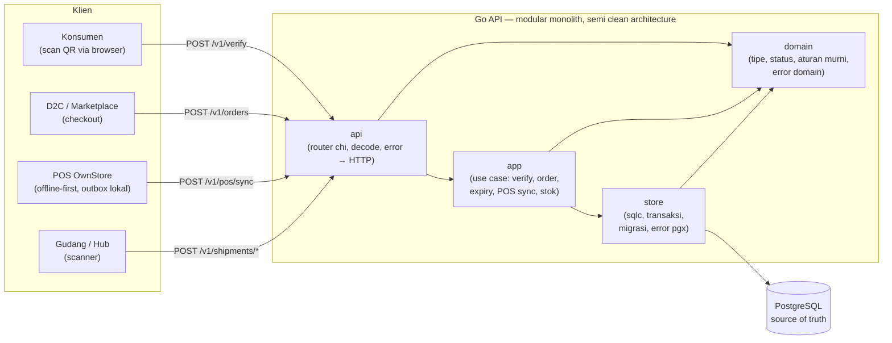
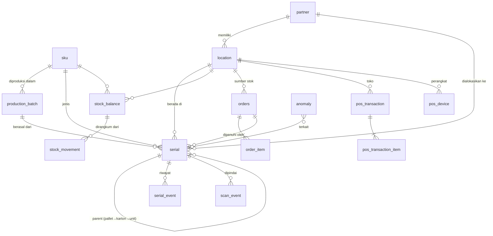
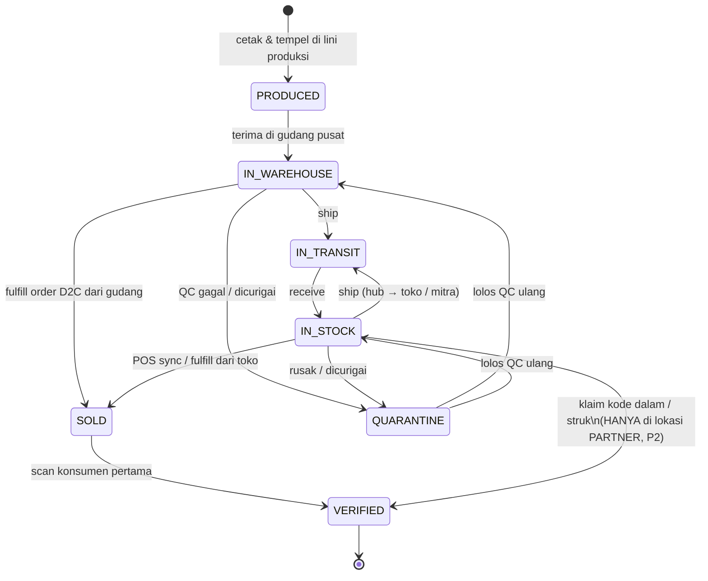
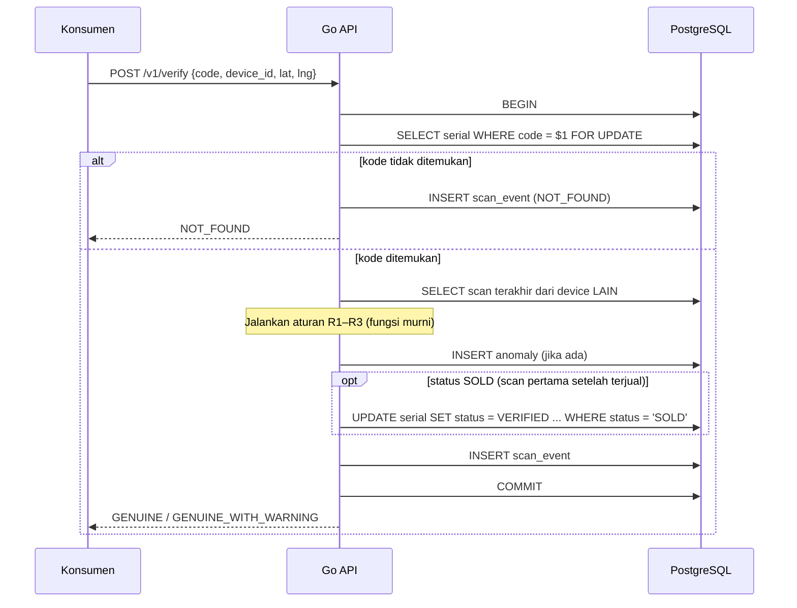
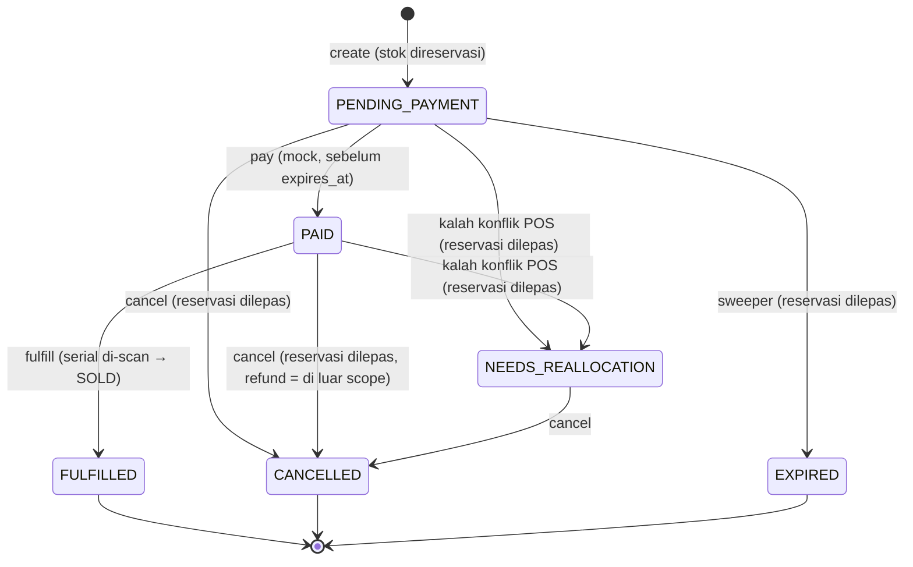
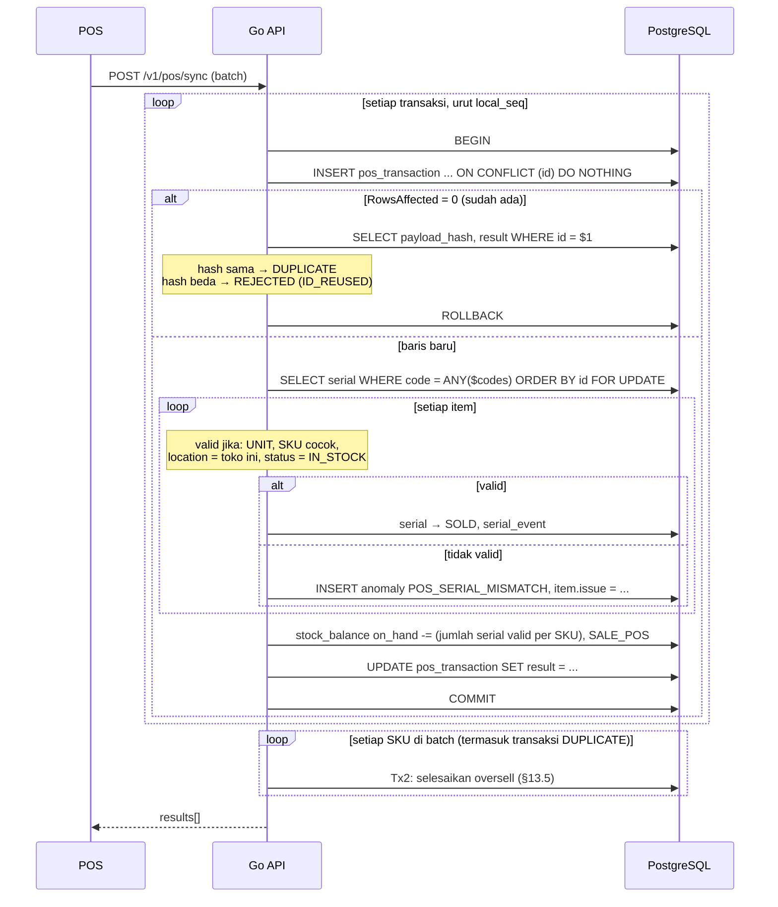

# Arsitektur — MGMI Product Engineer Assignment

> **Status:** Final (2026-11-05). Kebijakan bisnis, trade-off produk, dan metrik ada di `PRODUCT_DEFENSE.md`.

**Ringkasan satu menit**

1. **PostgreSQL adalah satu-satunya sumber kebenaran.** Tidak ada Redis atau cache stok. Semua keputusan stok terjadi di dalam transaksi DB (§3).
2. **Oversell dicegah oleh satu conditional `UPDATE`** yang mengecek dan memesan stok sekaligus (§12.3). Dibuktikan oleh 100 goroutine yang berebut stok 10 (T1).
3. **POS offline tidak pernah memotong stok dua kali.** Setiap transaksi kasir membawa UUID dari perangkat sebagai primary key (§13.4).
4. **Fakta fisik menang.** Penjualan kasir selalu diterima; jika bentrok, order online D2C terbaru yang dialihkan (§13.5).
5. **Setiap unit, karton, dan pallet punya QR.** Scan konsumen menjadi sensor keaslian dan gray market (§8, §10).
6. **Satu urutan kunci global** untuk semua operasi, sehingga bebas deadlock tanpa retry (§12.4). Setiap endpoint punya graf panggilan dan daftar titik patah (§16).

---

## Daftar Isi

1. [Ringkasan Keputusan](#1-ringkasan-keputusan)
2. [Scope](#2-scope)
3. [Prinsip Desain](#3-prinsip-desain)
4. [Arsitektur Komponen](#4-arsitektur-komponen)
5. [Tech Stack](#5-tech-stack)
6. [Struktur Repository](#6-struktur-repository)
7. [Model Data](#7-model-data)
8. [Serialisasi & Agregasi Produk (Pilar A)](#8-serialisasi--agregasi-produk-pilar-a)
9. [Siklus Hidup Serial (Pilar A)](#9-siklus-hidup-serial-pilar-a)
10. [Verifikasi Keaslian & Anti-Counterfeit Radar (Pilar A)](#10-verifikasi-keaslian--anti-counterfeit-radar-pilar-a)
11. [Manajemen Stok Terpusat / ATP (Pilar B)](#11-manajemen-stok-terpusat--atp-pilar-b)
12. [Siklus Hidup Pesanan & Pencegahan Overselling (Pilar B)](#12-siklus-hidup-pesanan--pencegahan-overselling-pilar-b)
13. [POS OwnStore: Offline-First Retail (Pilar C)](#13-pos-ownstore-offline-first-retail-pilar-c)
14. [Supply Chain Command Center (Pilar D)](#14-supply-chain-command-center-pilar-d)
15. [Spesifikasi API](#15-spesifikasi-api)
16. [Design Graph per Endpoint](#16-design-graph-per-endpoint)
17. [Ringkasan Strategi Konkurensi](#17-ringkasan-strategi-konkurensi)
18. [Automated Test Suite](#18-automated-test-suite)
19. [Parameter & Kebijakan Default](#19-parameter--kebijakan-default)
20. [Batasan Sistem (Trade-offs)](#20-batasan-sistem-trade-offs)
21. [Lampiran: Pemetaan ke Kasus 1–4](#21-lampiran-pemetaan-ke-kasus-14)
22. [Lampiran: Pelajaran dari Sistem Sebelumnya](#22-lampiran-pelajaran-dari-sistem-sebelumnya)

---

## 1. Ringkasan Keputusan

| Area | Keputusan | Alasan singkat |
|---|---|---|
| Bentuk sistem | **Modular monolith** (1 service Go) | Cukup untuk prototype. Batas antar-modul jelas lewat package. Microservices tidak menambah nilai untuk penilaian. |
| Bahasa | **Go** | Familiar, konkurensi mudah dites (`goroutine`), binary tunggal. |
| Database | **PostgreSQL** (single source of truth) | Transaksi ACID, row-level locking, constraint kuat, recursive CTE untuk agregasi. |
| Akses DB | **sqlc + pgx/v5** | SQL ditulis manual (terlihat dan bisa dipertahankan saat review), kode Go type-safe. |
| Skema | **Migrasi goose v3** (file SQL berurutan, di-embed ke binary) | Satu sumber skema untuk API, test, dan sqlc. API menjalankan migrasi saat start. Hanya maju (*forward-only*), tanpa migrasi down. |
| Model stok | **Counter per (SKU, lokasi)** + **tabel serial per unit** + **ledger append-only** | Counter untuk janji (reservasi). Serial untuk fakta fisik. Ledger untuk audit. |
| Reservasi stok | **Atomic conditional `UPDATE`** | Tanpa lock eksplisit, tanpa Redis. Terbukti benar lewat race test. |
| Transisi status | **Conditional `UPDATE ... WHERE status = $expected`** | Mencegah dua proses mengubah status yang sama secara bersamaan. |
| Urutan kunci | **Satu urutan global** (`orders` → `serial` → `stock_balance`, masing-masing urut ID), tanpa pengecualian | Mencegah deadlock lintas operasi (§12.4). Tanpa retry otomatis: deadlock = bug. |
| Reservasi kedaluwarsa | **`orders.expires_at` + sweeper per order** | Order yang tidak dibayar tidak mengunci stok selamanya (§12.7). |
| POS offline | **Outbox lokal di POS + `POST /pos/sync` idempoten, dua tahap** | UUID dari POS menjadi primary key. Retry tidak memotong stok dua kali. Oversell diselesaikan di transaksi terpisah (§13.3). |
| Konflik POS vs online | **Penjualan fisik selalu diterima.** Order online yang kalah dialihkan. | Barang sudah keluar fisik dan tidak bisa dibatalkan. |
| Test | **Unit test** (fungsi murni, tanpa DB) + **integration test** (PostgreSQL asli via testcontainers-go, migrasi yang sama dengan produksi) | `go test ./...` menjalankan keduanya. `go test -short ./...` hanya unit test, untuk loop cepat saat coding. |
| Frontend | **Tidak ada** (P2: satu halaman HTML verifikasi) | Assignment hanya meminta *mock endpoint*. POS disimulasikan lewat test dan `make demo`. |

---

## 2. Scope

### 2.1 Pemetaan ke deliverable assignment

| Deliverable wajib (assignment bagian 4) | Dipenuhi oleh |
|---|---|
| 1. Working Prototype: verifikasi serial hologram beserta logika anti-fraud | `POST /v1/verify` (§10) |
| 1. Working Prototype: alokasi stok pesanan dengan proteksi konkurensi | `POST /v1/orders` (§12) |
| 1. Working Prototype: mock endpoint rekonsiliasi transaksi offline POS | `POST /v1/pos/sync` (§13) |
| 2. Dokumentasi Arsitektur & Desain Data (`ARCHITECTURE.md`) | Dokumen ini |
| 3. Analisis Solusi Kasus Operasional (`PRODUCT_DEFENSE.md`) | Dokumen terpisah. Dokumen ini hanya menyiapkan kaitan teknisnya (§21). |
| 4. Automated Test Suite: proteksi race condition pada stok | §18, test T1–T2 |
| 4. Automated Test Suite: validasi siklus status hologram | §18, test T3–T4 |
| 4. Automated Test Suite: idempotensi sync offline | §18, test T5–T7 |
| Tambahan: pemisahan unit vs integration test, migrasi | §18.1, §18.5–18.6, test T20 |

### 2.2 Prioritas fitur

Prioritas agar mudah dipangkas bila waktu habis:

- **P0** = wajib (langsung diminta assignment)
- **P1** = dibangun setelah semua P0 selesai; membantu demo dan cerita bisnis
- **P2** = hanya didokumentasikan, tidak dikode

| Fitur | Prioritas | Catatan |
|---|---|---|
| Migrasi skema (goose) + seed data demo | P0 | |
| Verifikasi serial + aturan anomali R0–R3 | P0 | |
| Buat order (reservasi atomik, multi-item, lokasi dari klien) | P0 | |
| Cancel order (lepas reservasi, idempoten) | P0 | |
| Pay order (mock) | P0 | Hanya ubah status. Tidak ada payment gateway. Menolak order yang sudah kedaluwarsa. |
| POS sync idempoten + deteksi oversell | P0 | |
| POS heartbeat (ATP online toko = 0 saat offline) | P0 | Lapis pencegahan Kasus 4. P0 karena `ReserveStock` (P0) bergantung padanya: tanpa heartbeat, toko selalu dianggap offline. |
| Expiry reservasi (TTL + sweeper) | P1 | Naik dari P2: Pilar B meminta pelepasan stok kembali |
| `make demo` (skrip curl skenario presentasi) | P1 | Assignment wajib dipresentasikan |
| Fulfill order (scan serial → `SOLD`) | P1 | Melengkapi siklus order dan siklus serial |
| Ship/receive container (pallet/karton) | P2 | Di prototype, lokasi serial dan `partner_id` (Kasus 1) diisi lewat seed |
| `GET /v1/stock` (lihat ATP) | P2 | |
| Quarantine/QC endpoint | P2 | Transisi tetap ada di state machine dan dites |
| Realokasi otomatis order yang kalah | P2 | P0 hanya menandai `NEEDS_REALLOCATION` + melepas reservasi |
| Dashboard stok, Days of Inventory | P2 | Query/view ditulis di dokumen |
| Halaman HTML `/v/{code}` untuk demo scan QR | P2 | Statis, memanggil `POST /v1/verify` |
| Klaim poin loyalti (Kasus 2) | P2 | Desain tabel di §21 |
| Atribusi marketing (Kasus 3) | P2 | Hanya di `PRODUCT_DEFENSE.md` |

### 2.3 Sengaja tidak dibangun (tulis di README)

Frontend / aplikasi POS, CouchDB/RxDB, Redis, message queue, microservices, autentikasi & otorisasi, rate limiting, payment gateway, integrasi lini produksi, reverse geocoding, observability stack.

Alasan: tidak diminta assignment. Setiap komponen tambahan menambah risiko waktu tanpa menambah nilai pada rubrik. Batasan ini ditulis eksplisit sebagai bagian dari *product thinking*.

---

## 3. Prinsip Desain

1. **PostgreSQL adalah satu-satunya sumber kebenaran.** Tidak ada cache stok di luar DB. Semua keputusan stok terjadi di dalam transaksi DB.
2. **Invariant dijaga oleh database, bukan hanya oleh kode.** `UNIQUE`, `CHECK`, `PRIMARY KEY`, dan conditional `UPDATE` adalah garis pertahanan terakhir. Bug di kode Go tidak boleh membuat data rusak.
3. **Fakta fisik menang atas janji digital.** Penjualan di kasir, barang yang sudah dikirim, dan scan yang sudah terjadi selalu dicatat. Janji (reservasi online) yang menyesuaikan.
4. **Riwayat tidak ditulis ulang.** Perubahan stok dicatat di `stock_movement`. Perubahan status serial dicatat di `serial_event`. Koreksi adalah entri baru, bukan `UPDATE` pada riwayat.
5. **Status yang berbeda dipisah.** Status order, status pembayaran, dan status serial adalah tiga hal berbeda. Order yang sudah dibayar belum tentu sudah dikirim.
6. **Jangan percaya jam perangkat.** Waktu dari POS atau HP konsumen hanya disimpan sebagai informasi. Keputusan memakai waktu server.

---

## 4. Arsitektur Komponen

### 4.1 Gambaran besar (target produksi, bukan semua dibangun)



### 4.2 Lapisan dan aturan dependensi

Struktur memakai **semi clean architecture**: lapisan dipisah dengan aturan import yang ketat, tetapi tanpa interface dan mock yang tidak punya implementasi kedua.

| Lapisan | Isi | Boleh import | Tidak boleh |
|---|---|---|---|
| `domain` | Tipe, status, aturan murni (transisi serial, aturan anomali, verdict, haversine, hash payload POS), semua sentinel error | stdlib dan `google/uuid` (tipe nilai, tanpa I/O) | `app`, `store`, `api`, pgx, chi |
| `app` | Use case per endpoint (= graf §16): membuka transaksi, mengatur alur, menghasilkan error domain. `app/stock.go` adalah **satu-satunya** penulis `stock_balance` (§11.3). | `domain`, `store` | `api`, chi, `net/http` |
| `store` | Kode hasil sqlc, `InTx`, migrasi goose, terjemahan error pgx → error domain | `domain`, pgx, goose | `app`, `api` |
| `api` | Router chi, handler, decode + validasi input (boundary), satu-satunya mapping error → HTTP | `app`, `domain`, `config` | `store`, pgx |
| `config`, `logging` | Infrastruktur lintas lapisan (§5.2–5.3) | library masing-masing | — |
| `cmd/api` | Composition root: merangkai semua lapisan | semua | — |

```ts
cmd/api
  → api → app → store → domain
               └────────→ domain
  → config, logging
```

**Kenapa "semi":** pada clean architecture penuh, `app` hanya mengenal *interface* repository dan test menukarnya dengan mock. Di sini `app` langsung memakai `*store.Store` karena test memakai PostgreSQL asli (race condition hanya terbukti di DB asli) dan `store` hanya punya satu implementasi. Yang dijaga ketat: `domain` tetap murni, dan `api` tidak pernah menyentuh database.

**Menghindari pengulangan:**

| Pola berulang | Di repo ini |
|---|---|
| Interface + mock per repository | Tidak ada; test memakai DB asli |
| Method repository yang hanya meneruskan query | Tidak ada; `app` memanggil method hasil sqlc lewat `store` |
| Enum ditulis dua kali (tipe DB + tipe domain) | Satu tipe: override sqlc memetakan enum PostgreSQL ke tipe di `domain` |
| Satu struct service per fitur | Satu `app.Service` dengan method per use case |
| Sentinel error tersebar | Satu file: `domain/errors.go` |
| Nama berulang (`order.OrderService`, `order_handler.go`) | Nama package sudah menjelaskan lapisan: `app.CreateOrder`, `api/order.go` |

**Aturan transaksi:** use case di `app` membuka satu transaksi DB per operasi bisnis lewat `store.InTx` (di dalamnya `pgx.BeginFunc`). Semua query di dalam operasi itu memakai transaksi yang sama. Fungsi pembantu di `app` (misalnya `reserve`, `release`) tidak membuka transaksi sendiri. Dengan begitu satu operasi (misalnya satu transaksi kasir di POS sync) seluruhnya *commit* atau seluruhnya *rollback*. Rollback dijamin oleh `pgx.BeginFunc`, termasuk saat fungsi keluar lebih awal karena error.

---

## 5. Tech Stack

| Komponen | Pilihan | Alternatif yang ditolak | Alasan |
|---|---|---|---|
| Bahasa | Go 1.27 (`go 1.27` di `go.mod`) | Node.js/TS, Python | Familiar; race test dengan goroutine natural; `go test -race` |
| HTTP | `github.com/go-chi/chi/v5` (v5.5.0, di-pin di `go.mod`) | `net/http` stdlib saja, Gin, Echo | Grouping `r.Route("/v1", ...)` dan middleware siap pakai (`Recoverer`, `Timeout`); request ID dari zerolog `hlog` (§5.2). Handler tetap `http.HandlerFunc` biasa, dan chi mengisi `r.PathValue`, jadi handler tidak terikat ke chi. Satu modul tanpa dependensi turunan. Stdlib Go 1.22+ sudah mendukung method + `{id}`, tetapi tidak punya grouping dan middleware bawaan. Gin dan Echo memakai tipe handler sendiri (`gin.Context`, `echo.Context`). |
| DB driver | `pgx/v5` v5.12.0 + `pgxpool` | `database/sql` + lib/pq | Performa, dukungan tipe PostgreSQL penuh, didukung sqlc |
| Query | `sqlc` 1.31.1, dijalankan lewat image Docker `sqlc/sqlc:1.31.1` | GORM, sqlx, query builder | SQL eksplisit (penting untuk menjelaskan konkurensi), type-safe, tanpa magic ORM. Parser PostgreSQL sqlc butuh cgo; lewat Docker tidak perlu instalasi lokal. Kode hasil sqlc di-commit. |
| DB | PostgreSQL 18 (`postgres:18-alpine`) | MySQL, MongoDB | Recursive CTE, `ON CONFLICT`, partial index, `CHECK` multi-kolom, EvalPlanQual re-check (§12.3) |
| UUID | `github.com/google/uuid` v1.6.0 (v7) | — | ID transaksi POS dibuat di perangkat. v7 terurut waktu sehingga ramah index. |
| Test | `testing` stdlib + **testify** v1.12.1 (`require`, `assert`) + PostgreSQL asli via **testcontainers-go** v0.44.0 | Mock DB, sqlmock; `TEST_DATABASE_URL` + `t.Skip` | Race condition hanya bisa dibuktikan di DB asli. testcontainers membuat `go test ./...` menjalankan semua test tanpa setup manual. Skip diam-diam membuat hasil terlihat hijau padahal race test tidak jalan. |
| Migrasi | `github.com/pressly/goose/v3` v3.29.0 (dijalankan sebagai library; CLI hanya untuk membuat file baru) | golang-migrate | Lihat §5.1 |
| Config | **viper** v1.21.0 | `os.Getenv`, envconfig | Satu struct `Config` dari `config.yaml` + env var `MGMI_*` + default. Lihat §5.3. |
| Logging | **zerolog** v1.35.1 + `hlog` (middleware HTTP) + pgx `tracelog` | `log/slog`, zap | Log request masuk sampai selesai, dan log query SQL (hanya local), semuanya membawa `request_id` yang sama. Lihat §5.2. |
| Validasi input | Ditulis manual di fungsi `decodeXxx` (§16.1 Boundary) | go-playground/validator | Aturannya sedikit (qty > 0, UUID, format kode serial). Kode manual lebih mudah dibela daripada struct tag. |
| Lint | golangci-lint v2.15.0 | — | Dijalankan di CI |
| CI | GitHub Actions: `make test` | — | Runner GitHub punya Docker, jadi integration test (testcontainers) ikut jalan. Badge hijau = bukti test berjalan. |
| Image | Multi-stage: `golang:1.27-alpine` → `gcr.io/distroless/static` | `alpine` sebagai runtime | Binary statis (`CGO_ENABLED=0`), image kecil, tanpa shell |
| Runtime lokal | docker-compose (postgres + api) | Kubernetes | Penilai cukup `docker compose up` |

### 5.1 Migration tool: goose v3

| Tool | Format file | Embed ke binary Go | Dibaca sqlc | Catatan |
|---|---|---|---|---|
| **goose v3** (dipilih) | Satu file `.sql` per versi, bagian `-- +goose Up` | Ya (`goose.SetBaseFS` + `embed.FS`) | Ya | Library + CLI. Di PostgreSQL setiap file migrasi berjalan di dalam transaksi: jika gagal, skema kembali ke versi sebelumnya. Pernah dipakai (v2) di sistem sebelumnya. |
| golang-migrate | Pasangan `.up.sql` / `.down.sql` | Ya (source `iofs`) | Ya | Jika migrasi gagal di tengah, DB ditandai *dirty* dan harus dibereskan manual dengan perintah `force`. |

**Cara kerja.** Migrasi di-embed ke binary, lalu dijalankan oleh kode yang sama di dua tempat: `cmd/api` saat start, dan `testdb` sebelum integration test. Jadi skema yang dites **sama persis** dengan skema yang berjalan.

Kode: `internal/store/migrate.go`, fungsi `store.Migrate(ctx, databaseURL)` (goose `SetBaseFS` + `SetDialect("postgres")` + `UpContext`).

Urutan start API: baca `DATABASE_URL` → `sql.Open("pgx", ...)` → `store.Migrate` → tutup koneksi itu → `pgxpool.New` → jalankan server. Di docker-compose, service `api` menunggu `postgres` sehat (`depends_on: condition: service_healthy`).

**Aturan migrasi:**

| Aturan | Alasan |
|---|---|
| Nama file berurutan: `00001_init.sql`, `00002_...`. Dibuat dengan `make migration name=...` (goose CLI, flag `-s`). | Urutan jelas, tidak bentrok antar-tanggal |
| **Forward-only**: tidak ada bagian `-- +goose Down`. Kesalahan diperbaiki dengan migrasi baru. | Sederhana. Rollback skema tidak diminta. |
| File yang sudah di-commit tidak diedit lagi | Versi yang sudah tercatat di `goose_db_version` tidak akan dijalankan ulang |
| Seed data demo **bukan** migrasi. `make seed` menjalankan `db/seed/seed.sql` (diawali `TRUNCATE`) lewat `psql` di container. | Data demo tidak boleh ikut ke lingkungan lain. `make seed` sekaligus me-reset demo sebelum presentasi. |
| Single instance | goose dijalankan oleh satu proses API. Banyak instance butuh langkah migrasi terpisah (di luar scope). |

### 5.2 Logging: zerolog

Tiga jenis log. Semuanya lewat zerolog dan membawa `request_id` yang sama, jadi satu request bisa diikuti dari masuk sampai selesai, termasuk query SQL-nya.

| Log | Kapan | Field | Lingkungan |
|---|---|---|---|
| `request started` | Request masuk, sebelum handler | `request_id`, `method`, `url`, `remote` | Semua |
| `request completed` | Response selesai ditulis, termasuk 500 dari panic | Di atas + `status`, `size`, `duration` | Semua |
| `sql Query` | Setiap query pgx/sqlc selesai | `sql`, `args`, `duration`, `commandTag` (atau `err` jika gagal) | **Hanya `app.env = local`** |

Urutan middleware (dipasang sekali di `api.NewRouter`):

```ts
hlog.NewHandler(logger)                              // logger dasar masuk ke context request
  → hlog.RequestIDHandler("request_id", "X-Request-Id")
    → hlog.MethodHandler, URLHandler, RemoteAddrHandler
      → logRequestStarted                            // "request started"
        → hlog.AccessHandler(logRequestCompleted)    // "request completed"
          → middleware.Recoverer (chi)               // panic → 500, tetap tercatat sebagai completed
            → middleware.Timeout (chi)
              → handler
                → modul → pgx (tracer SQL, hanya local)
```

**Log SQL.** `tracelog.TraceLog` dari pgx dipasang di `pgxpool.Config.ConnConfig.Tracer` **hanya jika `app.env = local`**. Adapter kecil meneruskan log ke `zerolog.Ctx(ctx)`, sehingga query membawa `request_id` dari request yang menjalankannya. Query di luar request (sweeper, §12.7) memakai logger dasar lewat `zerolog.DefaultContextLogger`. SQL dicatat di level `debug`, jadi `log.level` lokal harus `debug`.

Kenapa hanya local: `args` berisi nilai asli parameter query, yang bisa memuat data pribadi (prinsip UU PDP di `PRODUCT_DEFENSE.md`).

Detail yang sudah dicek di source library:

| Hal | Penanganan |
|---|---|
| pgx menamai field durasi `time`, bentrok dengan field timestamp zerolog | `TraceLogConfig{TimeKey: "duration"}` |
| pgx mencatat query sukses di level Info dan gagal di level Error | Adapter memetakan sukses → zerolog `debug`, gagal → zerolog `error` |
| `hlog.RequestIDHandler` membuat ID baru (xid) dan menulisnya ke header response | Klien bisa mengutip `X-Request-Id` saat melapor masalah |

Format: `local` → `zerolog.ConsoleWriter` (mudah dibaca di terminal); selain itu → JSON satu baris per log.

Contoh satu request di format JSON (nilai *contoh*):

```json
{"level":"info","request_id":"d4nq8k3g2v7c","method":"POST","url":"/v1/orders","remote":"172.18.0.1:53122","time":"2026-11-05T09:15:22Z","message":"request started"}
{"level":"debug","request_id":"d4nq8k3g2v7c","sql":"UPDATE stock_balance sb SET reserved = ...","args":[1,2,1,"D2C"],"duration":1.2,"commandTag":"UPDATE 1","time":"2026-11-05T09:15:22Z","message":"sql Query"}
{"level":"info","request_id":"d4nq8k3g2v7c","status":201,"size":184,"duration":7.4,"time":"2026-11-05T09:15:22Z","message":"request completed"}
```

### 5.3 Config: viper

Prioritas: **env var `MGMI_*` > `config.yaml` > default**. `config.yaml` opsional dan tidak di-commit (`.gitignore`); `config.example.yaml` di-commit sebagai contoh lokal. Di docker-compose semua nilai diberikan lewat env var.

| Key | Env var | Default | Keterangan |
|---|---|---|---|
| `app.env` | `MGMI_APP_ENV` | `local` | `local` = log console + log SQL |
| `http.port` | `MGMI_HTTP_PORT` | `8080` | |
| `http.request_timeout` | `MGMI_HTTP_REQUEST_TIMEOUT` | `10s` | Untuk middleware `Timeout` |
| `database.url` | `MGMI_DATABASE_URL` | — | **Wajib.** API gagal start jika kosong. |
| `log.level` | `MGMI_LOG_LEVEL` | `info` | `config.example.yaml` memakai `debug` agar log SQL terlihat |
| `sweeper.interval` | `MGMI_SWEEPER_INTERVAL` | `30s` | Sweeper expiry (§12.7) |

**Jebakan viper (sudah dicek):** `Unmarshal` hanya membaca env var untuk key yang sudah dikenal viper. Karena itu **setiap key wajib punya `SetDefault`**, termasuk `database.url` (default string kosong, lalu divalidasi).

---

## 6. Struktur Repository

```
product-engineer-test/            # github.com/HafidhIrsyad/product-engineer-test
├── cmd/api/main.go               # composition root: config → logger → store.Migrate → store → app → api → server
├── internal/
│   ├── domain/                   # tipe, status, aturan murni, error. Tanpa I/O.
│   │   ├── serial.go             #   SerialStatus, CanTransition, format kode serial
│   │   ├── verify.go             #   aturan R1–R3, verdict, haversine
│   │   ├── order.go              #   OrderStatus
│   │   ├── pos.go                #   PayloadHash, hasil per transaksi POS
│   │   └── errors.go             #   semua sentinel error
│   ├── app/                      # use case = graf §16
│   │   ├── service.go            #   Service (satu struct), Health
│   │   ├── verify.go             #   Verify
│   │   ├── order.go              #   CreateOrder, PayOrder, CancelOrder
│   │   ├── expiry.go             #   ExpireDue, RunExpirySweeper
│   │   ├── pos.go                #   SyncPOS (Tx1 + Tx2), Heartbeat
│   │   └── stock.go              #   reserve, release, sellPOS: satu-satunya penulis stok
│   ├── store/                    # PostgreSQL
│   │   ├── migrations/           #   goose *.sql (dibaca sqlc DAN di-embed ke binary)
│   │   ├── queries/              #   *.sql sumber sqlc
│   │   ├── migrate.go            #   Migrate(ctx, databaseURL)
│   │   ├── store.go              #   Store: Open, InTx, Ping, Close
│   │   ├── errors.go             #   pgconn 23505 / CHECK → error domain
│   │   └── db.go, models.go, *.sql.go   # HASIL SQLC: di-commit, tidak diedit manual
│   ├── api/                      # HTTP
│   │   ├── router.go             #   NewRouter: chi + middleware + semua route
│   │   ├── health.go, verify.go, order.go, pos.go   # handler + decode (boundary)
│   │   ├── respond.go            #   writeJSON
│   │   └── errors.go             #   satu-satunya mapping error → HTTP
│   ├── config/config.go          # viper (§5.3)
│   ├── logging/logging.go        # zerolog, middleware request, tracer SQL (§5.2)
│   └── testdb/testdb.go          # helper testcontainers: Pool, reset, AssertInvariants
├── db/seed/seed.sql              # data demo; diawali TRUNCATE, aman dijalankan ulang
├── scripts/demo.sh               # skenario presentasi (curl), dipanggil `make demo`
├── .github/workflows/test.yml    # CI: lint + make test
├── config.example.yaml           # contoh config lokal; config.yaml di-.gitignore
├── Dockerfile                    # golang:1.27-alpine → distroless/static
├── .dockerignore
├── .golangci.yml
├── .gitignore
├── docker-compose.yml
├── sqlc.yaml
├── Makefile                      # up / down / seed / run / test / test-unit / test-integration / lint / sqlc / migration / demo
├── README.md
├── ARCHITECTURE.md
└── PRODUCT_DEFENSE.md
```

Test diletakkan di samping package. Unit test dan integration test ada di package yang sama, dibedakan oleh nama fungsi (§18.2).

```yaml
# sqlc.yaml
version: "2"
sql:
  - engine: "postgresql"
    schema: "internal/store/migrations"   # sqlc membaca bagian "+goose Up"
    queries: "internal/store/queries"
    gen:
      go:
        package: "store"
        out: "internal/store"             # satu package dengan kode tulisan tangan store
        sql_package: "pgx/v5"
        overrides:
          - db_type: "uuid"
            go_type: "github.com/google/uuid.UUID"
          - db_type: "timestamptz"
            go_type: "time.Time"
          # Enum PostgreSQL dipetakan langsung ke tipe domain (tanpa tipe ganda),
          # ditambahkan bersama tipe domain-nya, misalnya:
          # - db_type: "serial_status"
          #   go_type: "github.com/HafidhIrsyad/product-engineer-test/internal/domain.SerialStatus"
```

---

## 7. Model Data

### 7.1 ERD



### 7.2 Daftar tabel dan perannya

| Tabel | Peran | Menjawab pertanyaan |
|---|---|---|
| `sku` | Master produk | Produk apa? |
| `production_batch` | Batch produksi + tanggal kedaluwarsa | Kapan dan di batch mana dibuat? |
| `partner` | Distributor / mitra ritel + wilayah resmi | Siapa boleh menjual di mana? |
| `location` | Pabrik, gudang pusat, hub, toko sendiri, lokasi mitra | Di mana barang berada? |
| `serial` | Satu baris per kode QR (unit, karton, pallet) | Unit ini sekarang di mana, statusnya apa, milik alokasi siapa? |
| `serial_event` | Riwayat transisi serial (append-only) | Jejak lengkap unit dari pabrik sampai konsumen |
| `stock_balance` | Counter stok per (SKU, lokasi) | Berapa yang bisa dijanjikan sekarang? |
| `stock_movement` | Ledger perubahan counter (append-only) | Kenapa angka stok berubah? |
| `orders`, `order_item` | Order online | Siklus order |
| `pos_transaction`, `pos_transaction_item` | Transaksi kasir dari POS | Apa yang sudah terjual di toko? Sudah diproses? |
| `pos_device` | Perangkat POS per toko + heartbeat | Apakah semua kasir toko ini sedang online? |
| `scan_event` | Semua scan konsumen | Siapa, di mana, kapan memindai? |
| `anomaly` | Temuan yang perlu ditinjau manusia | Apa yang mencurigakan? |

### 7.3 Potongan DDL penting

DDL lengkap ada di `internal/store/migrations/00001_init.sql`. Di sini hanya tabel yang constraint-nya menjadi bagian dari pembelaan desain.

```sql
CREATE TABLE orders (
    id               BIGINT GENERATED ALWAYS AS IDENTITY PRIMARY KEY,
    -- Dikirim klien lewat header Idempotency-Key. Retry tidak membuat order ganda.
    idempotency_key  UUID NOT NULL UNIQUE,
    channel          TEXT NOT NULL CHECK (channel IN ('D2C', 'MARKETPLACE')),
    location_id      BIGINT NOT NULL REFERENCES location(id),
    status           order_status NOT NULL DEFAULT 'PENDING_PAYMENT',
    -- Batas bayar. Lewat dari ini, reservasi dilepas (§12.7).
    expires_at       TIMESTAMPTZ NOT NULL,
    created_at       TIMESTAMPTZ NOT NULL DEFAULT now(),
    updated_at       TIMESTAMPTZ NOT NULL DEFAULT now()
);

CREATE TABLE stock_balance (
    sku_id       BIGINT NOT NULL REFERENCES sku(id),
    location_id  BIGINT NOT NULL REFERENCES location(id),
    on_hand      INT NOT NULL DEFAULT 0 CHECK (on_hand >= 0),
    reserved     INT NOT NULL DEFAULT 0 CHECK (reserved >= 0),
    quarantine   INT NOT NULL DEFAULT 0 CHECK (quarantine >= 0 AND quarantine <= on_hand),
    updated_at   TIMESTAMPTZ NOT NULL DEFAULT now(),
    PRIMARY KEY (sku_id, location_id)
    -- SENGAJA TIDAK ADA: CHECK (on_hand - reserved - quarantine >= 0).
    -- Alasan: penjualan POS offline adalah fakta fisik yang harus bisa dicatat,
    -- walaupun sesaat membuat reserved > tersedia. Kondisi itu dideteksi dan
    -- diselesaikan di §13.5, bukan ditolak oleh constraint.
);

CREATE TABLE pos_transaction (
    -- UUIDv7 yang dibuat oleh perangkat POS = idempotency key.
    id              UUID PRIMARY KEY,
    store_id        BIGINT NOT NULL REFERENCES location(id),
    device_id       TEXT   NOT NULL,
    -- Nomor urut lokal di perangkat. Untuk urutan proses dan deteksi celah.
    local_seq       BIGINT NOT NULL,
    -- Waktu menurut perangkat. Hanya informasi, tidak dipakai untuk keputusan.
    occurred_at     TIMESTAMPTZ NOT NULL,
    received_at     TIMESTAMPTZ NOT NULL DEFAULT now(),
    -- SHA-256 dari payload kanonik. Mendeteksi UUID yang dipakai ulang untuk isi berbeda.
    payload_hash    BYTEA  NOT NULL,
    total_amount    BIGINT NOT NULL CHECK (total_amount >= 0),  -- rupiah, tanpa desimal
    payment_method  TEXT   NOT NULL CHECK (payment_method IN ('CASH', 'CARD', 'QRIS')),
    result          TEXT   NOT NULL CHECK (result IN ('ACCEPTED', 'ACCEPTED_WITH_ISSUES')),
    UNIQUE (device_id, local_seq)
);
```

### 7.4 Konvensi data

| Hal | Konvensi | Alasan |
|---|---|---|
| Uang | `BIGINT` rupiah | Tanpa float. Rupiah tidak memakai sen. |
| Waktu | `TIMESTAMPTZ`, UTC | Toko tersebar di WIB/WITA/WIT |
| ID internal | `BIGINT IDENTITY` | Sederhana, cepat |
| ID dari perangkat | `UUID` v7 | Bisa dibuat offline tanpa bentrok |
| Kode serial | String acak 13 karakter (Crockford base32, `crypto/rand`) | Tidak bisa ditebak atau di-enumerasi (lihat §8.1) |

---

## 8. Serialisasi & Agregasi Produk (Pilar A)

### 8.1 Format kode serial

- Isi QR: URL verifikasi, contoh `https://verify.<domain>/v/MG7K2Q9XHD4PZ`.
  Konsumen cukup memindai dengan kamera HP, tanpa aplikasi.
- Kode: prefix `MG` + 11 karakter acak base32 (≈ 55 bit acak).
- **Kenapa acak, bukan berurutan:** kode berurutan (`...0001`, `...0002`) mudah ditebak. Pemalsu bisa mencetak kode "sah" yang belum dipakai.
  Dengan 55 bit acak dan target jutaan unit, peluang menebak kode valid sangat kecil.
- **Kenapa tidak memakai tanda tangan kriptografis (HMAC) di QR:** verifikasi selalu online ke DB, jadi keberadaan kode di DB sudah cukup sebagai bukti.
  HMAC baru berguna untuk verifikasi offline. Itu tidak diminta.
- **Batasan yang diakui:** kode asli bisa **difotokopi**. Kode acak tidak mencegah kloning.
  Kloning dideteksi lewat pola scan (§10): satu kode dipindai di banyak tempat.

### 8.2 Hierarki agregasi

```
PALLET  MGPALxxxxx
 ├── CARTON  MGCTNxxxxx
 │    ├── UNIT  MGxxxxxxxxxxx
 │    ├── UNIT  ...
 │    └── ... (units_per_carton)
 └── CARTON ...
      └── ... (cartons_per_pallet)
```

- Relasi disimpan di `serial.parent_id` (self-reference). Cukup satu kolom.
- Unit, karton, dan pallet sama-sama baris di tabel `serial` dengan `level` berbeda. Satu mekanisme scan untuk semua level.
- **Validasi level** (di Go, saat packing): parent unit harus `CARTON`, parent karton harus `PALLET`. Pallet tidak punya parent.
  Trigger DB tidak dipakai agar logika tetap terlihat di satu tempat.
- Stok (`stock_balance`) hanya menghitung **UNIT**. Karton dan pallet adalah alat angkut, bukan barang jual.

### 8.3 Operasi pada container

Mengambil semua unit di bawah satu pallet atau karton:

```sql
-- name: ListUnitsUnderContainer :many
-- Rekursif dari container ke bawah sampai level UNIT.
WITH RECURSIVE tree AS (
    SELECT s.id, s.level
    FROM serial s
    WHERE s.id = sqlc.arg(container_id)
  UNION ALL
    SELECT c.id, c.level
    FROM serial c
    JOIN tree t ON c.parent_id = t.id
)
SELECT s.*
FROM serial s
JOIN tree t ON t.id = s.id
WHERE t.level = 'UNIT'
ORDER BY s.id
FOR UPDATE OF s;   -- kunci semua unit agar tidak berubah saat diproses
```

**Ship (P2):** `POST /v1/shipments/ship { container_code, to_location_code }`

1. Ambil container dan semua unit di bawahnya (`FOR UPDATE`).
2. Validasi: semua unit berstatus `IN_WAREHOUSE` atau `IN_STOCK`, dan berada di lokasi asal yang sama.
3. Ubah semua serial (container + unit) menjadi `IN_TRANSIT`, `location_id = tujuan`.
   Jika tujuan adalah lokasi `PARTNER`, isi `partner_id` ← **di sinilah unit "diikat" ke distributor**.
4. `stock_balance` lokasi asal: `on_hand -= n` (alasan `SHIP_OUT`).
5. Tulis `serial_event` per unit (bulk `INSERT ... SELECT`) dan `stock_movement`.

**Receive (P2):** `POST /v1/shipments/receive { container_code, location_code }`

1. Ambil unit di bawah container dengan status `IN_TRANSIT` dan `location_id = lokasi ini`.
2. Ubah menjadi `IN_STOCK`. `stock_balance` lokasi tujuan: `on_hand += n` (alasan `RECEIVE`).

**Membuka karton di toko:** `parent_id` **tidak dihapus** saat unit dijual satuan. `parent_id` berarti "pernah dikemas dalam", dan itu adalah bukti untuk Kasus 1.
Jika ada pengemasan ulang (repack), `parent_id` diubah dan dicatat di `serial_event` dengan `ref_type = 'PACKING'`.

### 8.4 Membuktikan titik kebocoran distributor (Kasus 1)

Satu unit ditemukan dipindai di Jakarta, padahal dialokasikan ke distributor Medan:

```sql
-- Jejak lengkap satu unit: dari pabrik sampai scan konsumen.
SELECT se.created_at, se.from_status, se.to_status,
       l.name AS lokasi, p.name AS distributor, se.ref_type, se.ref_id
FROM serial_event se
LEFT JOIN location l ON l.id = se.location_id
LEFT JOIN partner  p ON p.id = se.partner_id
WHERE se.serial_id = (SELECT id FROM serial WHERE code = 'MG7K2Q9XHD4PZ')
ORDER BY se.created_at;

-- Agregasi bukti per distributor: berapa unit alokasinya dipindai di luar wilayah.
SELECT p.name, COUNT(*) AS unit_bocor
FROM anomaly a
JOIN partner p ON p.id = a.partner_id
WHERE a.type = 'OUT_OF_REGION'
GROUP BY p.name
ORDER BY unit_bocor DESC;
```

**Satu scan di luar wilayah adalah sinyal lemah.** Bisa jadi konsumen sedang bepergian, atau membeli online secara sah. Bukti menjadi kuat jika **banyak unit dari pallet yang sama** muncul di wilayah lain. Di sinilah hierarki agregasi bekerja:

```sql
-- Cluster kebocoran per pallet: dari unit pallet ini yang pernah dipindai,
-- berapa yang dipindai di luar wilayah distributornya.
-- Ambang relatif, karena scan coverage konsumen rendah dan berbeda per wilayah.
WITH unit_pallet AS (
    SELECT u.id AS serial_id, u.partner_id, pal.code AS pallet
    FROM serial u
    JOIN serial ctn ON ctn.id = u.parent_id   AND ctn.level = 'CARTON'
    JOIN serial pal ON pal.id = ctn.parent_id AND pal.level = 'PALLET'
    WHERE u.level = 'UNIT' AND u.partner_id IS NOT NULL
)
SELECT p.name                        AS distributor,
       up.pallet,
       COUNT(DISTINCT se.serial_id)  AS unit_dipindai,
       COUNT(DISTINCT a.serial_id)   AS unit_di_luar_wilayah
FROM unit_pallet up
JOIN partner p     ON p.id = up.partner_id
JOIN scan_event se ON se.serial_id = up.serial_id
LEFT JOIN anomaly a ON a.serial_id = up.serial_id AND a.type = 'OUT_OF_REGION'
GROUP BY p.name, up.pallet
HAVING COUNT(DISTINCT a.serial_id) >= 3                                -- contoh
   AND COUNT(DISTINCT a.serial_id) >= 0.3 * COUNT(DISTINCT se.serial_id) -- contoh
ORDER BY unit_di_luar_wilayah DESC;
```

| Tingkat bukti | Kondisi | Tindakan |
|---|---|---|
| Sinyal | 1 unit di luar wilayah | Dicatat saja |
| Indikasi | ≥ 3 unit **dan** ≥ 30% dari unit pallet itu yang pernah dipindai (*contoh*) | Peringatan ke tim sales area |
| Bukti | Indikasi + **test-buy** dari seller marketplace yang dicurigai, unitnya dipindai, dan ternyata milik alokasi distributor itu | Dasar penegakan kontrak subsidi (perlu review legal) |

Hasilnya: daftar unit, karton, dan pallet yang bocor, berikut tanggal pengirimannya ke distributor. Tidak perlu inspeksi fisik.

---

## 9. Siklus Hidup Serial (Pilar A)

### 9.1 Diagram



### 9.2 Tabel transisi

| Dari | Ke | Pemicu | Syarat tambahan |
|---|---|---|---|
| `PRODUCED` | `IN_WAREHOUSE` | Receive di gudang pusat | Lokasi tujuan bertipe `CENTRAL_WAREHOUSE` |
| `IN_WAREHOUSE` | `IN_TRANSIT` | Ship | — |
| `IN_STOCK` | `IN_TRANSIT` | Ship | Lokasi asal bukan `PARTNER` (barang di mitra tidak kita kirim ulang) |
| `IN_TRANSIT` | `IN_STOCK` | Receive | `location_id` sama dengan lokasi penerima |
| `IN_WAREHOUSE` | `SOLD` | Fulfill order | Serial sesuai SKU order, di lokasi order |
| `IN_STOCK` | `SOLD` | POS sync / fulfill | Lokasi bertipe `OWN_STORE` atau `HUB` |
| `SOLD` | `VERIFIED` | Scan konsumen pertama setelah terjual | — |
| `IN_STOCK` | `VERIFIED` | Klaim poin dengan kode dalam / struk (P2) | **Hanya** di lokasi `PARTNER`. Scan QR luar **tidak** mengubah status. |
| `IN_WAREHOUSE`, `IN_STOCK` | `QUARANTINE` | QC (P2) | — |
| `QUARANTINE` | `IN_WAREHOUSE`, `IN_STOCK` | QC ulang (P2) | Kembali ke tipe lokasi semula |

**Bukti terjual di lokasi mitra:**
POS Indomaret dan distributor tidak memberi tahu kita kapan unit terjual. Scan QR **luar** bukan bukti terjual, karena siapa saja bisa memindainya di rak: calon pembeli yang mengecek keaslian, atau kasir. Bukti terjual di mitra adalah **kode lapis dalam** (hanya terlihat setelah segel dibuka) atau struk, yang dipakai saat klaim poin (§21). Saat itulah status menjadi `VERIFIED` dan stok mitra dicatat terjual (`SELL_OUT_INFERRED`). Scan luar hanya dicatat di `scan_event`.
Di toko sendiri kita **tahu** kapan terjual (POS). Scan sebelum `SOLD` juga tidak mengubah status.

### 9.3 Implementasi

**Di Go** — aturan transisi sebagai data, bukan `if` yang tersebar:

```go
// allowed memetakan status asal ke status tujuan yang sah.
// Syarat tambahan (tipe lokasi, dll.) dicek oleh pemanggil.
var allowed = map[Status][]Status{
	Produced:    {InWarehouse},
	InWarehouse: {InTransit, Sold, Quarantine},
	InTransit:   {InStock},
	InStock:     {InTransit, Sold, Verified, Quarantine},
	Sold:        {Verified},
	Quarantine:  {InWarehouse, InStock},
	Verified:    {}, // status akhir
}

func CanTransition(from, to Status) bool {
	return slices.Contains(allowed[from], to)
}
```

**Di DB** — guard terhadap race (dua proses mengubah serial yang sama bersamaan):

```sql
-- name: TransitionSerial :execrows
UPDATE serial
SET status = sqlc.arg(to_status), updated_at = now()
WHERE id = sqlc.arg(id)
  AND status = sqlc.arg(from_status);
-- RowsAffected == 0 → status sudah diubah proses lain → kembalikan ErrStaleStatus
```

Dua lapis ini saling melengkapi: Go menolak transisi yang **tidak sah**. DB menolak transisi yang **sudah basi** (status berubah sejak dibaca).

---

## 10. Verifikasi Keaslian & Anti-Counterfeit Radar (Pilar A)

### 10.1 Endpoint

`POST /v1/verify` — `POST`, bukan `GET`, karena setiap scan dicatat (ada efek tulis).

Request:

```json
{
  "code": "MG7K2Q9XHD4PZ",
  "device_id": "d-4f1c9a",
  "lat": -6.2088,
  "lng": 106.8456
}
```

Response (asli, tanpa peringatan):

```json
{
  "verdict": "GENUINE",
  "product": { "sku": "MGN-PROT-500", "name": "mGanik Protein 500g" },
  "batch": { "code": "B2611-01", "expires_on": "2028-05-01" },
  "first_verified_at": "2026-11-05T10:12:00Z",
  "scan_count": 1
}
```

Response (asli, tetapi ada peringatan):

```json
{
  "verdict": "GENUINE_WITH_WARNING",
  "message": "Kode ini sudah pernah diverifikasi sebelumnya. Jika Anda baru membeli produk ini, hubungi layanan pelanggan.",
  "first_verified_at": "2026-08-01T03:00:00Z",
  "scan_count": 7
}
```

**Detail aturan tidak ditampilkan ke konsumen.** Pemalsu tidak boleh tahu aturan mana yang memicu peringatan. Detail hanya ada di tabel `anomaly`.

Menampilkan `first_verified_at` adalah anti-counterfeit sederhana tetapi kuat. Konsumen yang baru membeli lalu melihat "pertama diverifikasi 3 bulan lalu" langsung tahu ada yang salah.

### 10.2 Alur



`FOR UPDATE` pada serial memastikan dua scan pertama yang bersamaan tidak sama-sama dianggap "pertama".

### 10.3 Aturan anomali

Semua aturan adalah **fungsi murni** di package `domain` (input: serial, scan sekarang, scan sebelumnya, data partner). Mudah dites tanpa DB.

| ID | Aturan | Logika | Menjawab |
|---|---|---|---|
| R0 | Kode tidak dikenal | Kode tidak ada di DB → verdict `NOT_FOUND`. Dicatat di `scan_event` saja, **bukan** di `anomaly`. | Barang palsu dengan kode karangan. Bot yang menebak kode tidak membanjiri tabel `anomaly`; laporannya diambil dari agregasi `scan_event` dengan verdict `NOT_FOUND`. |
| R1 | `IMPOSSIBLE_TRAVEL` | Dibandingkan dengan scan terakhir dari **device lain**: jarak > 100 km **dan** kecepatan > 800 km/jam | QR asli dikloning dan beredar di kota lain |
| R2 | `SCAN_BEFORE_RELEASE` | Status `PRODUCED`, `IN_WAREHOUSE`, `IN_TRANSIT`, atau `QUARANTINE` | Barang bocor dari pabrik/gudang, atau kode dikloning sebelum rilis |
| R3 | `OUT_OF_REGION` | `serial.partner_id` terisi **dan** jarak lokasi scan ke pusat wilayah partner > `region_radius_km` | Gray market (Kasus 1 + Pilar D early warning). Per scan = sinyal lemah; diagregasi per pallet di §8.4 menjadi bukti. |

Penjelasan angka R1:
- **> 100 km**: abaikan perbedaan kecil karena GPS tidak akurat atau perpindahan dalam satu kota.
- **> 800 km/jam**: di atas kecepatan pesawat komersial. Orang yang membawa produk naik pesawat tidak terkena.
- Hanya dibandingkan dengan **device lain**: satu orang yang memindai dua kali tidak dianggap anomali.

Jarak dihitung dengan rumus haversine (`domain.HaversineKm`, fungsi murni).

### 10.4 Penentuan verdict

| Kondisi | Verdict |
|---|---|
| R0 | `NOT_FOUND` |
| Ada R1, R2, atau R3, **atau** kode sudah dipindai oleh ≥ 3 device berbeda (*contoh*) | `GENUINE_WITH_WARNING` |
| Selain itu | `GENUINE` |

Ambang "≥ 3 device berbeda" mencegah peringatan palsu: orang yang mengecek di rak atau keluarga yang memindai ulang tidak membuat pembeli asli melihat peringatan.

### 10.5 Batasan yang diakui

- Lokasi dari browser **bisa dipalsukan** dan bisa ditolak oleh pengguna (`lat`/`lng` kosong). Jika kosong, R1 dan R3 dilewati.
- Wilayah sebagai lingkaran adalah penyederhanaan. Produksi: polygon (PostGIS) atau kode kabupaten/kota.
- Tidak ada rate limiting. Produksi: batasi per IP dan per device untuk mencegah enumerasi kode.

---

## 11. Manajemen Stok Terpusat / ATP (Pilar B)

### 11.1 Arti setiap angka

| Kolom | Istilah di assignment | Arti |
|---|---|---|
| `on_hand` | Stok fisik nyata | Unit fisik di lokasi (termasuk yang dikarantina) |
| `reserved` | Stok yang sedang dialokasikan/dipesan | Unit yang sudah dijanjikan ke order online, tetapi belum diambil dari rak |
| `quarantine` | Stok bermasalah/karantina | Bagian dari `on_hand` yang ditahan dan tidak boleh dijual |

```
ATP (Available-to-Purchase)  = on_hand − reserved − quarantine
ATP online (lokasi toko)     = ATP − online_buffer
                               dan 0 jika ada device POS aktif yang heartbeat-nya > 5 menit lalu
                               dan 0 untuk order MARKETPLACE (stok toko hanya untuk D2C)
```

Stok yang sedang dikirim (`IN_TRANSIT`) **tidak** masuk `on_hand` lokasi mana pun. Stok itu terlihat lewat tabel `serial` (§14).

### 11.2 Invariant (dicek di test)

Untuk setiap (SKU, lokasi):

```
I1:  on_hand  = COUNT(serial UNIT di lokasi itu, status ∈ {IN_WAREHOUSE, IN_STOCK, QUARANTINE})
I2:  reserved = SUM(order_item.qty) untuk order di lokasi itu dengan status ∈ {PENDING_PAYMENT, PAID}
```

Hanya dua invariant ini yang dites. Ledger (`stock_movement`) ditulis oleh fungsi yang sama dengan counter (§11.3), jadi kecocokan counter dan ledger tidak perlu dites terpisah. Kolom `quarantine` belum berubah di prototype karena endpoint QC masih P2.

```sql
-- name: CheckOnHandInvariant :many
-- Mengembalikan baris yang TIDAK konsisten. Hasil kosong = sehat.
SELECT sb.sku_id, sb.location_id, sb.on_hand, COALESCE(s.cnt, 0) AS serial_count
FROM stock_balance sb
LEFT JOIN (
    SELECT sku_id, location_id, COUNT(*) AS cnt
    FROM serial
    WHERE level = 'UNIT' AND status IN ('IN_WAREHOUSE', 'IN_STOCK', 'QUARANTINE')
    GROUP BY sku_id, location_id
) s ON s.sku_id = sb.sku_id AND s.location_id = sb.location_id
WHERE sb.on_hand <> COALESCE(s.cnt, 0);
```

Query ini dipakai di akhir setiap test integrasi. Di produksi bisa dijalankan sebagai job rekonsiliasi berkala.

### 11.3 Aturan menulis stok

Semua perubahan `stock_balance` lewat fungsi di **`app/stock.go`** (`reserve`, `release`, `sellPOS`, ...). Setiap fungsi itu selalu:
1. Meng-`UPDATE` `stock_balance`.
2. Meng-`INSERT` `stock_movement` dengan delta yang sama.
3. Di dalam transaksi yang sama dengan pemanggil.

Tidak ada kode lain yang boleh menulis `stock_balance` langsung.

---

## 12. Siklus Hidup Pesanan & Pencegahan Overselling (Pilar B)

### 12.1 Status order



**Stok direservasi saat order dibuat**, bukan saat dibayar. Alasan: mencegah konsumen membayar untuk barang yang ternyata habis.
Konsekuensinya: reservasi yang tidak dibayar harus kedaluwarsa. `expires_at = created_at + 15 menit` (P1, §12.7).

### 12.2 Membuat order

`POST /v1/orders` dengan header `Idempotency-Key: <uuid>`

```json
{
  "channel": "D2C",
  "location_code": "WH-JKT",          // wajib: lokasi sumber stok
  "items": [
    { "sku_code": "MGN-PROT-500", "qty": 2 },
    { "sku_code": "MGN-COLL-200", "qty": 1 }
  ]
}
```

Alur:

1. Cek `idempotency_key`. Jika sudah ada order dengan key itu → kembalikan order tersebut (HTTP 200). Tidak ada reservasi baru.
2. Buka transaksi:
   1. `INSERT orders` (status `PENDING_PAYMENT`, `expires_at = now() + 15 menit`).
   2. Untuk setiap item, **diurutkan berdasarkan `sku_id`** (mencegah deadlock, §12.4): jalankan `ReserveStock`.
   3. Jika ada satu item yang `RowsAffected = 0` → `ROLLBACK`, HTTP 409 `INSUFFICIENT_STOCK`.
   4. Jika semua berhasil → tulis `stock_movement` (`RESERVE`), `COMMIT`.

Penyederhanaan: satu order dipenuhi dari **satu lokasi**, dan lokasinya dipilih oleh klien (checkout D2C/marketplace sudah tahu gudang pengirimnya). Pemilihan lokasi otomatis dan split shipment di luar scope.

Race pada idempotency key: dua request dengan key yang sama bersamaan → keduanya `INSERT`, yang kedua kena `UNIQUE` violation (menunggu yang pertama commit). Tangkap error `23505` → baca order yang sudah ada → kembalikan (200).

### 12.3 Mekanisme locking reservasi (inti pencegahan overselling)

```sql
-- name: ReserveStock :execrows
-- Atomik: cek ketersediaan dan tambah reserved dalam SATU statement.
-- Stok toko hanya untuk D2C, dan hanya jika semua device POS aktif online.
UPDATE stock_balance sb
SET reserved   = sb.reserved + sqlc.arg(qty)::int,
    updated_at = now()
FROM location l
WHERE l.id = sb.location_id
  AND sb.sku_id      = sqlc.arg(sku_id)
  AND sb.location_id = sqlc.arg(location_id)
  AND l.online_sellable
  AND (l.type <> 'OWN_STORE' OR (
        sqlc.arg(channel)::text = 'D2C'
        AND NOT EXISTS (
            SELECT 1 FROM pos_device d
            WHERE d.store_id = l.id AND d.active
              AND d.last_heartbeat_at < now() - interval '5 minutes')))
  AND sb.on_hand - sb.reserved - sb.quarantine - l.online_buffer >= sqlc.arg(qty)::int;
```

**Kenapa stok toko tidak untuk marketplace:** jika order marketplace kalah konflik dengan POS (§13.5), pembatalan dari sisi seller menurunkan skor performa toko di marketplace dan bisa kena penalti. Order D2C bisa dibatalkan tanpa penalti pihak ketiga.

**Kenapa ini aman tanpa `SELECT ... FOR UPDATE`:**

PostgreSQL di level `READ COMMITTED` (default) bekerja seperti ini saat dua transaksi meng-`UPDATE` baris yang sama:

1. Transaksi A mengunci baris dan meng-update `reserved`.
2. Transaksi B mencoba meng-update baris yang sama, lalu **menunggu** sampai A selesai.
3. Setelah A commit, B **mengevaluasi ulang kondisi `WHERE`** terhadap versi baris terbaru (mekanisme *EvalPlanQual*).
4. Jika stok sudah tidak cukup, kondisi gagal dan B meng-update 0 baris.

Jadi tidak mungkin dua transaksi sama-sama lolos dengan membaca angka lama. Ini dibuktikan oleh test T1 (§18).

**Alternatif yang ditolak:**

| Alternatif | Kenapa tidak |
|---|---|
| `SELECT ... FOR UPDATE` lalu `UPDATE` | Benar, tetapi 2 round-trip dan lebih banyak kode. Tidak lebih aman. |
| `SERIALIZABLE` isolation | Benar, tetapi butuh logika retry untuk error `40001`. Tambahan kompleksitas tanpa manfaat di kasus ini. |
| Redis lock / `DECR` | Dua sumber kebenaran. Jika Redis dan PostgreSQL tidak sinkron, terjadi overselling atau stok "hilang". |
| Optimistic locking dengan kolom `version` | Di bawah lonjakan, banyak request gagal dan harus retry. Conditional update tidak butuh retry. |

### 12.4 Pencegahan deadlock

Order A: [SKU-1, SKU-2]. Order B: [SKU-2, SKU-1].
Jika diproses sesuai urutan input: A mengunci SKU-1 lalu menunggu SKU-2, sementara B mengunci SKU-2 lalu menunggu SKU-1. Terjadi **deadlock**.

Solusi: **item selalu diurutkan berdasarkan `sku_id` sebelum reservasi.** Semua transaksi mengunci baris dengan urutan yang sama, jadi siklus tunggu tidak mungkin terjadi.

**Deadlock lintas operasi.** Mengurutkan SKU saja tidak cukup. Operasi yang berbeda bisa mengunci tabel dengan urutan terbalik. Contoh: cancel mengunci `orders` lalu `stock_balance`. Jika POS sync memotong stok lalu mengunci order yang dikorbankan di transaksi yang sama, urutannya terbalik.

**Urutan kunci global** (semua operasi wajib mengikuti):

```
orders (urut id)  →  serial (urut id)  →  stock_balance (urut sku_id)
```

| Operasi | Kunci yang diambil | Sesuai urutan global? |
|---|---|---|
| Create order | `orders` (baru) → `stock_balance` | Ya |
| Pay / cancel / expiry | `orders` → `stock_balance` | Ya |
| Fulfill | `orders` → `serial` → `stock_balance` | Ya |
| Ship / receive | `serial` → `stock_balance` | Ya |
| Verify (`SOLD → VERIFIED`) | `serial` saja | Ya |
| POS sync Tx1 (catat penjualan) | `serial` → `stock_balance` | Ya |
| POS sync Tx2 (selesaikan oversell) | advisory lock toko → `orders` → `stock_balance` | Ya. Advisory lock hanya dipakai Tx2 (§13.5). |

Aturan turunan: serial dalam satu operasi selalu dikunci dengan satu query `... WHERE code = ANY($1) ORDER BY id FOR UPDATE`, bukan satu per satu sesuai urutan input.

**Tidak ada retry otomatis.** Semua operasi memakai `pgx.BeginFunc` biasa (commit jika sukses, rollback jika error). Jika PostgreSQL tetap melaporkan deadlock (`40P01`), itu berarti ada query yang melanggar urutan di atas. Itu bug: API mengembalikan HTTP 500, dan test T14 (§18) yang menangkapnya.

### 12.5 Cancel (idempoten)

```sql
-- name: LockOrder :one
-- Kunci baris order. Pemanggil lain menunggu sampai transaksi ini selesai,
-- lalu membaca status terbaru.
SELECT id, location_id, status FROM orders
WHERE id = sqlc.arg(id)
FOR UPDATE;

-- name: SetOrderStatus :exec
UPDATE orders SET status = sqlc.arg(status), updated_at = now()
WHERE id = sqlc.arg(id);
```

Alur (satu transaksi): jalankan `LockOrder`, lalu putuskan berdasarkan status di Go.

| Status saat dikunci | Tindakan | Respons |
|---|---|---|
| `PENDING_PAYMENT`, `PAID` | `SetOrderStatus(CANCELLED)`, lalu lepas reservasi per item (urut `sku_id`, `reserved -= qty`, alasan `RELEASE`) | 200 |
| `NEEDS_REALLOCATION` | `SetOrderStatus(CANCELLED)` saja. Reservasi sudah dilepas saat konflik. | 200 |
| `CANCELLED` | Tidak ada. **Stok tidak dilepas lagi.** | 200 (idempoten) |
| `EXPIRED` | Tidak ada. Stok sudah dilepas saat kedaluwarsa. | 200 dengan status `EXPIRED` |
| `FULFILLED` | Tidak ada | 409 `ORDER_NOT_CANCELLABLE` |

Satu mekanisme saja: **row lock**. Cancel ganda bersamaan: yang kedua menunggu kunci, lalu membaca status `CANCELLED` dan tidak melepas stok. Cancel vs fulfill sama: siapa yang mendapat kunci lebih dulu menang, yang lain melihat status baru.

### 12.6 Fulfill (P1)

`POST /v1/orders/{id}/fulfill` dengan daftar kode serial yang di-scan picker:

```json
{ "serial_codes": ["MG7K2Q9XHD4PZ", "MGA8...", "MGB2..."] }
```

Validasi (urutan kunci sesuai §12.4: order → serial → stok):
- Order berstatus `PAID` (dikunci `FOR UPDATE`).
- Semua serial dikunci sekaligus, urut `id`.
- Jumlah serial per SKU **sama persis** dengan `order_item.qty`.
- Setiap serial: level `UNIT`, SKU cocok, di lokasi order, status `IN_WAREHOUSE`/`IN_STOCK`, tidak duplikat di request.

Efek (satu transaksi):
- Serial → `SOLD`, `order_id` diisi, `serial_event`.
- `stock_balance`: `on_hand -= n`, `reserved -= n` (alasan `SALE_ONLINE`).
- Order → `FULFILLED`.

Ini adalah titik di mana **janji berbasis jumlah** (reservasi) berubah menjadi **unit fisik spesifik** (serial).

### 12.7 Expiry reservasi (P1)

Order `PENDING_PAYMENT` yang lewat `expires_at` melepas reservasinya. Tanpa ini, order yang ditinggalkan di halaman bayar mengunci stok selamanya.

**Sweeper:** goroutine di proses API (satu instance), berjalan setiap 30 detik. Cara kerjanya sama dengan cancel, hanya status tujuannya `EXPIRED`:

1. Ambil daftar order kedaluwarsa (tanpa kunci):
   ```sql
   -- name: ListExpiredOrderIDs :many
   SELECT id FROM orders
   WHERE status = 'PENDING_PAYMENT' AND expires_at < now();
   ```
2. Untuk setiap `id`, satu transaksi:
   ```sql
   -- name: ExpireOrder :one
   -- 0 baris → order sudah dibayar/dibatalkan sejak langkah 1. Lewati.
   UPDATE orders SET status = 'EXPIRED', updated_at = now()
   WHERE id = sqlc.arg(id)
     AND status = 'PENDING_PAYMENT'
     AND expires_at < now()
   RETURNING id;
   ```
   Jika 1 baris → lepas reservasi per item (urut `sku_id`, alasan `RELEASE`, `ref_type = 'ORDER_EXPIRY'`), lalu commit.

**Race pay vs expiry** diselesaikan oleh kondisi `WHERE`. Hanya satu yang menang:

```sql
-- name: PayOrder :execrows
-- RowsAffected = 0 → baca status:
--   PAID                                  → 200 (idempoten)
--   EXPIRED, atau PENDING_PAYMENT (sudah lewat expires_at, belum disapu) → 409 ORDER_EXPIRED
--   lainnya                               → 409 INVALID_ORDER_STATUS
UPDATE orders SET status = 'PAID', updated_at = now()
WHERE id = sqlc.arg(id)
  AND status = 'PENDING_PAYMENT'
  AND expires_at > now();
```

Order yang lewat `expires_at` tetapi belum disapu sweeper tetap tidak bisa dibayar. Kebenaran tidak bergantung pada seberapa cepat sweeper berjalan.

---

## 13. POS OwnStore: Offline-First Retail (Pilar C)

### 13.1 Resiliensi operasi kasir (sisi POS, didokumentasikan, tidak dibangun)

| Komponen di perangkat | Isi | Dipakai untuk |
|---|---|---|
| Cache katalog | SKU, harga | Kasir tetap bisa menghitung total saat offline |
| Cache serial toko | Daftar serial berstatus `IN_STOCK` di toko ini | Validasi scan hologram secara lokal saat offline |
| Stok lokal | Counter per SKU, diturunkan setiap penjualan | Kasir tidak menjual melebihi yang tercatat di toko |
| **Outbox** | Transaksi yang belum terkirim, urut `local_seq` | Dikirim saat online |
| Pembayaran offline | Tunai, atau EDC dengan koneksi SIM sendiri. QRIS dinonaktifkan saat offline. | Data pembayaran ikut di payload transaksi, jadi ikut dijaga idempotensi: tidak ada double-charge. |

Teknologi lokal: SQLite (aplikasi native/desktop) atau IndexedDB (aplikasi web). RxDB bisa dipakai di atas IndexedDB dengan replikasi HTTP ke endpoint Go. **Tidak memakai CouchDB**, karena replikasi dokumen tidak memahami aturan stok, dan logika rekonsiliasi harus terlihat di server.

Saat online, POS:
- Mengirim heartbeat setiap 1 menit (`POST /v1/pos/heartbeat`, P0).
- Mengirim outbox (`POST /v1/pos/sync`).
- Menarik cache serial dan harga terbaru.

### 13.2 Request dan response sync

Request `POST /v1/pos/sync`:

```json
{
  "store_code": "STORE-BDG-01",
  "device_id": "pos-bdg-01-a",
  "transactions": [
    {
      "id": "0193a5f2-7c1e-7b3a-9d2e-4f6a8b1c2d3e",
      "local_seq": 1042,
      "occurred_at": "2026-11-05T09:15:22+07:00",
      "payment_method": "CASH",
      "total_amount": 450000,
      "items": [
        { "serial_code": "MG7K2Q9XHD4PZ", "sku_code": "MGN-PROT-500", "price": 450000 }
      ]
    }
  ]
}
```

Response (HTTP 200, hasil **per transaksi**):

```json
{
  "results": [
    { "id": "0193a5f2-...", "status": "ACCEPTED" },
    { "id": "0193a5f3-...", "status": "DUPLICATE", "original_result": "ACCEPTED" },
    { "id": "0193a5f4-...", "status": "ACCEPTED_WITH_ISSUES",
      "issues": [{ "line_no": 1, "issue": "SERIAL_NOT_AT_STORE" }] },
    { "id": "0193a5f5-...", "status": "REJECTED", "error": "ID_REUSED_WITH_DIFFERENT_PAYLOAD" }
  ]
}
```

| Status | Arti | Tindakan POS |
|---|---|---|
| `ACCEPTED` | Diproses pertama kali, semua valid | Hapus dari outbox |
| `DUPLICATE` | Sudah pernah diproses (retry) | Hapus dari outbox |
| `ACCEPTED_WITH_ISSUES` | Penjualan dicatat, ada serial bermasalah → masuk `anomaly` untuk ditinjau | Hapus dari outbox |
| `REJECTED` | Payload rusak atau UUID dipakai ulang | **Jangan retry.** Tandai untuk dicek (bug perangkat) |

**Prinsip: penjualan yang sudah terjadi tidak pernah ditolak** karena masalah data serial. Uang sudah diterima dan barang sudah keluar. Masalahnya dicatat untuk ditinjau. `REJECTED` hanya untuk payload yang secara teknis tidak valid.

### 13.3 Validasi unit checkout dan alur sinkronisasi

Sync berjalan dalam **dua tahap**, masing-masing dengan transaksi DB terpisah:

- **Tahap 1 (Tx1, satu per transaksi POS):** catat penjualan, ubah serial, potong stok. Urut `local_seq`. Satu transaksi bermasalah tidak menggagalkan seluruh batch.
- **Tahap 2 (Tx2, setelah semua Tx1):** selesaikan oversell untuk setiap SKU di batch (§13.5).

Kenapa dipisah: POS baru tahu ada oversell **setelah** memotong stok. Jika keduanya satu transaksi, POS mengunci `stock_balance` lalu `orders`, kebalikan dari cancel (`orders` lalu `stock_balance`) → deadlock. Dengan dua tahap, setiap transaksi mengikuti urutan kunci global §12.4 tanpa pengecualian.



### 13.4 Rekonsiliasi & anti duplikasi (tanpa double-deduction stok atau double-charge)

| Risiko | Mekanisme | Di mana |
|---|---|---|
| POS mengirim ulang batch yang sama (timeout, jaringan putus setelah server commit) | `pos_transaction.id` = PRIMARY KEY + `ON CONFLICT DO NOTHING` | DB |
| Dua request sync yang sama tiba **bersamaan** | `INSERT` kedua **menunggu** commit yang pertama (unique index), lalu `DO NOTHING` → `DUPLICATE` | DB |
| Stok terpotong dua kali (double-deduction) | Pemotongan stok hanya terjadi di cabang "baris baru", di transaksi yang sama dengan `INSERT` | DB transaction |
| Pembayaran tercatat dua kali (double-charge) | Data pembayaran adalah bagian dari baris `pos_transaction` yang sama | DB |
| Bug perangkat: UUID sama untuk transaksi berbeda | `payload_hash` dibandingkan → `REJECTED` | Go |
| Bug perangkat: `local_seq` dipakai ulang | `UNIQUE (device_id, local_seq)` → error → `REJECTED` | DB |
| Serial yang sama dijual dua kali (kloning, atau dua kasir) | `SELECT ... FOR UPDATE` + validasi status `IN_STOCK`. Yang kedua → `POS_SERIAL_MISMATCH` | DB + Go |
| Dua transaksi POS mengunci serial sama dengan urutan berbeda (deadlock) | Semua serial dikunci dalam satu query `ORDER BY id` | DB |
| Retry dengan JSON yang urutan field-nya berbeda dianggap "isi berbeda" | `payload_hash` dari struct kanonik, bukan raw body (lihat di bawah) | Go |

**Hash payload kanonik:** jangan hash raw body, karena urutan field dan spasi bisa berbeda saat retry. Decode JSON ke struct, beri nomor item sesuai posisinya (`line_no` = urutan ke-1, 2, ...; urutan item ikut menjadi bagian payload), normalkan `occurred_at` ke UTC, lalu `json.Marshal` struct kanonik itu dan hash hasilnya. `json.Marshal` pada struct Go selalu mengeluarkan field dengan urutan yang sama.

```sql
-- name: InsertPosTransaction :execrows
INSERT INTO pos_transaction (
    id, store_id, device_id, local_seq, occurred_at,
    payload_hash, total_amount, payment_method, result
) VALUES (
    sqlc.arg(id), sqlc.arg(store_id), sqlc.arg(device_id), sqlc.arg(local_seq),
    sqlc.arg(occurred_at), sqlc.arg(payload_hash), sqlc.arg(total_amount),
    sqlc.arg(payment_method), 'ACCEPTED'   -- diperbarui di akhir jika ada issue
)
ON CONFLICT (id) DO NOTHING;
```

**Kenapa stok dipotong hanya untuk serial yang valid:** jika serial menurut data tidak ada di toko ini, kita tidak tahu angka mana yang salah. Mungkin data pengiriman salah, mungkin kode dikloning. Aturannya sederhana: stok hanya berubah jika serialnya berubah, jadi I1 (§11.2) selalu benar. Serial bermasalah masuk `anomaly`, lalu ops memperbaikinya lewat penyesuaian terkontrol.

Trade-off yang diakui: sampai anomali diselesaikan, `on_hand` toko bisa lebih besar dari stok fisik, sehingga order online bisa menjanjikan unit yang tidak ada. Risiko ini dibatasi oleh `online_buffer` dan ditulis di §20.

### 13.5 Split-brain stok (Kasus 4)

**Skenario:** Toko Bandung offline. Stok SKU X di toko = 1. Kasir menjual unit terakhir.
Pada saat yang sama, server masih melihat ATP = 1 dan menerima order online yang mereservasi unit itu.

> Catatan: lapis pencegahan (heartbeat + buffer di §12.3) membuat skenario ini **jarang**. Lapis pencegahan berlaku setelah heartbeat terlambat > 5 menit. Konflik tetap mungkin terjadi pada jeda itu, atau jika buffer = 0.

**Saat toko online dan sync:**

1. **Tx1:** penjualan POS **diterima** (fakta fisik). `on_hand`: 1 → 0. Sekarang `reserved (1) > on_hand − quarantine (0)`.
2. **Tx2:** untuk setiap SKU di batch, ulangi sampai tidak ada kekurangan. **Satu transaksi per order yang dikorbankan:**
   1. `pg_advisory_xact_lock(location_id)`: hanya satu Tx2 per toko pada satu waktu. Tanpa ini, dua sync bersamaan bisa sama-sama melihat kekurangan 1 dan mengorbankan 2 order.
   2. Hitung `shortfall = reserved − (on_hand − quarantine)`. Jika ≤ 0 → selesai.
   3. Ambil order **terbaru** di lokasi itu (status `PENDING_PAYMENT`/`PAID`, berisi SKU tersebut) dengan `FOR UPDATE`. Jika tidak ada → selesai.
   4. Lepas **seluruh** reservasinya (semua item, urut `sku_id`, alasan `RELEASE`), ubah status → `NEEDS_REALLOCATION`, catat `anomaly` `OVERSOLD`.
3. P2 / produksi: worker mencoba mereservasi ulang order itu di lokasi lain dengan `ReserveStock`. Jika gagal → tawarkan ke pelanggan: backorder, atau batal + refund otomatis + voucher.

Urutan kunci Tx2: advisory lock → `orders` → `stock_balance`. Sesuai urutan global §12.4. Advisory lock hanya dipakai Tx2, jadi tidak membentuk siklus dengan operasi lain.

Kenapa satu transaksi per order: jika semua order dikorbankan dalam satu transaksi, Tx2 sudah memegang `stock_balance` saat mengunci order berikutnya. Itu kembali ke urutan terbalik.

Jika Tx2 gagal, endpoint mengembalikan HTTP 500. POS mengirim ulang batch yang sama (perilaku outbox biasa). Tx1 menjadi `DUPLICATE`, dan Tx2 berjalan lagi karena Tx2 dijalankan untuk semua SKU di batch, termasuk yang `DUPLICATE`.

```sql
-- name: PickOversellVictim :one
SELECT o.id
FROM orders o
JOIN order_item oi ON oi.order_id = o.id AND oi.sku_id = sqlc.arg(sku_id)
WHERE o.location_id = sqlc.arg(location_id)
  AND o.status IN ('PENDING_PAYMENT', 'PAID')
ORDER BY o.created_at DESC
LIMIT 1
FOR UPDATE OF o;
```

**Kenapa order terbaru yang dikorbankan:** order lama sudah lebih lama menunggu dan lebih mungkin sudah dibayar dan dalam proses picking. Mengorbankan order terbaru meminimalkan gangguan. Aturan ini adalah **kebijakan bisnis** dan bisa diganti (misalnya: korbankan order yang belum dibayar dulu).

**Kenapa jam POS tidak dipakai untuk menentukan siapa yang lebih dulu:** jam perangkat offline bisa salah, dan hasilnya tetap sama: unit fisik sudah dibawa pulang pelanggan toko.

**Kebijakan untuk pelanggan online yang kalah** (detail di `PRODUCT_DEFENSE.md`):

| Langkah | Target |
|---|---|
| Realokasi otomatis ke gudang/hub lain | Dalam hitungan detik setelah sync |
| Jika gagal: notifikasi ke pelanggan | < 15 menit setelah toko sync |
| Pilihan untuk pelanggan | Tunggu restock (estimasi tanggal) **atau** batal + refund otomatis + voucher |

Metrik untuk menyetel `online_buffer` per toko: `conflict_rate` × biaya kompensasi per konflik, dibandingkan dengan penjualan online yang hilang karena buffer.

### 13.6 Heartbeat per perangkat (P0)

Heartbeat dicatat **per perangkat POS**, bukan per toko. Jika satu perangkat offline sementara perangkat lain online, perangkat yang offline tetap bisa menjual unit terakhir. Karena itu toko dianggap online hanya jika **semua** perangkat aktif mengirim heartbeat dalam 5 menit terakhir (§12.3). Perangkat yang tidak dipakai lagi dinonaktifkan oleh ops (`active = false`).

```sql
CREATE TABLE pos_device (
    id                 TEXT PRIMARY KEY,                       -- device_id dari POS
    store_id           BIGINT NOT NULL REFERENCES location(id),
    active             BOOLEAN NOT NULL DEFAULT true,
    last_heartbeat_at  TIMESTAMPTZ NOT NULL
);

-- name: TouchHeartbeat :execrows
-- Perangkat baru otomatis terdaftar sebagai aktif.
-- 0 baris = device_id sudah terdaftar di toko lain → 409 DEVICE_STORE_MISMATCH.
INSERT INTO pos_device (id, store_id, last_heartbeat_at)
VALUES (sqlc.arg(device_id), sqlc.arg(store_id), now())
ON CONFLICT (id) DO UPDATE SET last_heartbeat_at = now()
WHERE pos_device.store_id = EXCLUDED.store_id;
```

Tidak perlu job terpisah. Kondisi "offline" dihitung saat reservasi.

---

## 14. Supply Chain Command Center (Pilar D)

Pilar ini **tidak dikode** (P2) selain anomali R3 `OUT_OF_REGION` (sudah P0). Bagian ini menunjukkan bahwa data dari Pilar A–C sudah cukup untuk membangunnya.

### 14.1 Visibilitas sentral

```sql
-- Stok per lokasi, termasuk yang sedang dalam perjalanan menuju lokasi itu.
CREATE VIEW v_stock_overview AS
SELECT l.code AS location, l.type, s.code AS sku,
       sb.on_hand, sb.reserved, sb.quarantine,
       sb.on_hand - sb.reserved - sb.quarantine AS atp,
       (SELECT COUNT(*) FROM serial x
         WHERE x.level = 'UNIT' AND x.status = 'IN_TRANSIT'
           AND x.location_id = l.id AND x.sku_id = s.id) AS inbound
FROM stock_balance sb
JOIN location l ON l.id = sb.location_id
JOIN sku s      ON s.id = sb.sku_id;
```

### 14.2 Telemetri runout stok (Days of Inventory)

```
avg_daily_sales = total penjualan 14 hari terakhir / 14
                  (dari stock_movement: SALE_POS + SALE_ONLINE + SELL_OUT_INFERRED)
DOI             = (on_hand − quarantine) / avg_daily_sales
Peringatan      = DOI < lead_time_hari + safety_hari  (contoh: 7 + 3 = 10 hari)
```

Untuk lokasi mitra, penjualan berasal dari `SELL_OUT_INFERRED` (klaim kode dalam / struk, P2). Angkanya adalah **batas bawah**, karena tidak semua konsumen mengklaim. Rasio scan terhadap penjualan bisa dikalibrasi dari data toko sendiri, di mana penjualan nyata diketahui.

### 14.3 Peringatan dini anomali distribusi

Sudah tersedia dari anomali `OUT_OF_REGION` (R3), dikelompokkan per partner dan per minggu (§8.4).

---

## 15. Spesifikasi API

Semua path berawalan `/v1`. Format error seragam:

```json
{ "error": { "code": "INSUFFICIENT_STOCK", "message": "Stok tidak cukup untuk SKU MGN-PROT-500" } }
```

| Method | Path | Prioritas | Fungsi | Sukses | Error utama |
|---|---|---|---|---|---|
| `POST` | `/v1/verify` | P0 | Verifikasi keaslian + anomali | 200 | 422 input tidak valid |
| `POST` | `/v1/orders` | P0 | Buat order + reservasi | 201 (baru), 200 (idempotency key sama) | 409 `INSUFFICIENT_STOCK`; 422 (termasuk `UNKNOWN_LOCATION`, `UNKNOWN_SKU`) |
| `POST` | `/v1/orders/{id}/pay` | P0 | Mock pembayaran | 200 (termasuk jika sudah dibayar) | 404 `ORDER_NOT_FOUND`; 409 `ORDER_EXPIRED`, `INVALID_ORDER_STATUS` |
| `POST` | `/v1/orders/{id}/cancel` | P0 | Batal + lepas stok | 200 (termasuk jika sudah batal/kedaluwarsa) | 404 `ORDER_NOT_FOUND`; 409 `ORDER_NOT_CANCELLABLE` |
| `POST` | `/v1/pos/sync` | P0 | Rekonsiliasi transaksi offline | 200 (hasil per transaksi) | 422 jika seluruh body tidak valid |
| `POST` | `/v1/orders/{id}/fulfill` | P1 | Scan serial → `SOLD` | 200 | 404, 409, 422 |
| `POST` | `/v1/shipments/ship` | P2 | Kirim pallet/karton | 200 | 409 `INVALID_SERIAL_STATUS` |
| `POST` | `/v1/shipments/receive` | P2 | Terima pallet/karton | 200 | 409 |
| `POST` | `/v1/pos/heartbeat` | P0 | Tandai perangkat POS online (`store_code`, `device_id`) | 204 | 404 toko tidak ditemukan; 409 `DEVICE_STORE_MISMATCH` |
| `GET` | `/v1/stock?sku=&location=` | P2 | Lihat ATP | 200 | 404 |
| `GET` | `/healthz` | P0 | Health check (ping DB) | 200 | 503 |

Semua route didaftarkan di satu fungsi, `api.NewRouter(svc, logger, cfg.HTTP)`, di bawah `r.Route("/v1", ...)` (chi). Pemetaan error Go → HTTP dilakukan di satu tempat (`api/errors.go`) dengan sentinel error (`errors.Is`). Graf panggilan dan semua titik patah per endpoint ada di §16.

---

## 16. Design Graph per Endpoint

Setiap endpoint P0 digambar dulu sebagai **graf panggilan**, lalu kodenya ditulis sama persis dengan graf itu. Jika kode tidak cocok dengan grafnya, implementasinya yang salah. Setiap graf punya tiga saluran: **A** (data di jalur sukses), **E** (di mana graf bisa patah), dan **R** (apa yang dibutuhkan node). Metode ini diadaptasi dari *Design Thinking* berbasis Effect-TS ke konvensi Go.

### 16.1 Konvensi

| Langkah | Arti | Di proyek ini (Go) |
|---|---|---|
| Shapes | Kata benda domain | Tipe khusus, bukan `string` polos: `SerialCode` (prefix `MG` + base32, divalidasi konstruktor), `PosTxnID` (UUIDv7), `IdempotencyKey` (UUID). Enum status. Sentinel error per modul. |
| A | Jalur sukses | Isi fungsi hanya jalur sukses. Error langsung dikembalikan (`if err != nil { return err }`), tidak ditangani di tengah. |
| Kardinalitas | Satu nilai atau banyak | Handler = satu kali jalan. POS sync = banyak (loop per transaksi). Sweeper = aliran (ticker). Heartbeat = berlaku 5 menit. |
| E | Titik patah | **Escape**: hasil domain yang dikembalikan sebagai nilai (4xx, atau hasil per item). **Die**: bug atau infrastruktur → 500, detail hanya di log. **Retry**: hanya di **klien**, dan aman karena idempotensi. Server tidak pernah retry. |
| R | Kebutuhan node | Dikirim lewat parameter: `api` menerima `*app.Service`, `app.Service` memegang `*store.Store`, dan transaksi berjalan lewat `store.InTx` yang memberi query sqlc terikat ke `pgx.Tx`. Dependensi yang lupa diisi = compile error. Waktu diambil dari `now()` di DB, jadi tidak perlu jam aplikasi. |
| Boundary | Data tidak tepercaya masuk | Hanya di `api`: decode JSON + validasi → tipe input `app`. `app` tidak memvalidasi ulang bentuk input. |
| Behavior | Pembungkus | Middleware dipasang sekali di router: log request masuk dan selesai (zerolog `hlog`, §5.2), lalu `Recoverer` dan `Timeout` (chi). Tracer SQL dipasang di pool, bukan di modul. Tidak ada logging di dalam modul untuk jalur sukses. |
| Scope | Acquire / release | `pgx.BeginFunc` (rollback dijamin), `context` menghentikan sweeper, pool ditutup saat shutdown. |
| Swap R | Bukti | Test integrasi mengganti R dengan PostgreSQL asli di container (§18.3). **Tidak ada mock DB**, karena race condition hanya terbukti di DB asli. Fungsi murni (aturan transisi, anomali, verdict) dites tanpa R. |

**E di-scope per lapisan.** Setiap lapisan hanya menerjemahkan error dari lapisan tepat di bawahnya. Konsumen tidak pernah melihat error implementasi dari lapisan yang lebih dalam.

```ts
pgx / sqlc
  → pgconn 23505, CHECK 23514
    → store/errors.go                 // error driver → error domain
  → 0 baris pada conditional UPDATE
    → app                             // hasil bisnis → error domain
      → domain/errors.go: ErrInsufficientStock, ErrOrderNotFound, ErrOrderExpired, ErrInvalidOrderStatus,
        ErrOrderNotCancellable, ErrUnknownSKU, ErrUnknownLocation, ErrDeviceStoreMismatch
        → api/errors.go (satu-satunya tempat error → HTTP)
          → 404 / 409 / 422, atau 500 untuk semua error yang tidak dikenal (Die)
```

### 16.2 `POST /v1/verify`

Production:
```ts
POST /v1/verify (api)
  → decodeVerify                     // batas: code, device_id, lat/lng opsional
  → app.Verify
    → pgx.BeginFunc
      → GetSerialByCodeForUpdate
      → GetScanContext               // scan terakhir dari device lain + jumlah device berbeda
      → domain.Evaluate              // fungsi murni: R1–R3 + verdict (§10.3–10.4)
      → InsertAnomaly                // hanya jika ada aturan yang terpicu
      → TransitionSerial             // hanya SOLD → VERIFIED
      → InsertScanEvent
  → 200 VerifyView
```

Tests:
```ts
TestEvaluate (unit: T11, T18)
  → domain.Evaluate                  // tanpa DB
TestIntegration_Verify (T12)
  → httptest.Server
    → api
      → app.Verify
        → testdb.Pool
```

| Node | E | Jenis | Hasil |
|---|---|---|---|
| `decodeVerify` | `code` kosong, format salah, `lat` tanpa `lng` | Escape | 422 |
| `GetSerialByCodeForUpdate` | Kode tidak ada | Escape | 200 `NOT_FOUND`, `scan_event` tetap dicatat |
| `TransitionSerial` | 0 baris | Die | 500. Tidak mungkin terjadi karena baris sudah dikunci; jika terjadi, ada bug. |
| Semua | Error DB | Die | 500 |

R: `*store.Store`. Data wilayah partner dibaca dari DB; jarak dihitung oleh `domain.HaversineKm` (fungsi murni).

### 16.3 `POST /v1/orders`

Production:
```ts
POST /v1/orders (api)
  → decodeCreateOrder                // batas: Idempotency-Key, channel, location_code, items
  → app.CreateOrder
    → GetOrderByIdempotencyKey       // sudah ada → kembalikan order itu
    → pgx.BeginFunc
      → GetLocationByCode, GetSKUsByCode
      → InsertOrder                  // expires_at = now() + 15 menit
      → app.reserve                // per item, urut sku_id
        → ReserveStock               // conditional UPDATE (§12.3)
        → InsertStockMovement (RESERVE)
  → 201 OrderView
```

Tests:
```ts
TestIntegration_CreateOrder_NoOversell (T1), _NoDeadlock (T2), _Idempotent (T8), _StoreRules (T22)
  → app.CreateOrder
    → testdb.Pool
TestIntegration_OrderHTTP (T21)
  → httptest.Server → api → app.CreateOrder → testdb.Pool
```

| Node | E | Jenis | Hasil |
|---|---|---|---|
| `decodeCreateOrder` | Header tidak ada, qty ≤ 0, channel tidak dikenal | Escape | 422 |
| `GetLocationByCode`, `GetSKUsByCode` | Kode tidak ada | Escape | 422 `UNKNOWN_LOCATION` / `UNKNOWN_SKU` |
| `InsertOrder` | `23505` pada `idempotency_key` (request kembar bersamaan) | Escape | 200, order yang sudah ada |
| `ReserveStock` | 0 baris | Escape | 409 `INSUFFICIENT_STOCK`, transaksi di-rollback |
| Semua | `40P01` deadlock | Die | 500. Bug urutan kunci (§12.4), ditangkap T14. |
| Semua | Error DB lain | Die | 500. Klien boleh retry dengan key yang sama. |

R: `*store.Store`.

### 16.4 `pay`, `cancel`, dan sweeper expiry

Production:
```ts
POST /v1/orders/{id}/pay (api)
  → app.PayOrder
    → PayOrder                       // satu conditional UPDATE (§12.7)
    → GetOrderStatus                 // hanya jika 0 baris
  → 200 OrderView

POST /v1/orders/{id}/cancel (api)
  → app.CancelOrder
    → pgx.BeginFunc
      → LockOrder                    // FOR UPDATE (§12.5)
      → SetOrderStatus (CANCELLED)   // keputusan dari status di Go
      → app.release                // per item, urut sku_id
  → 200 OrderView

app.RunExpirySweeper              // goroutine, tiap 30 detik, berhenti saat ctx selesai
  → app.ExpireDue                  // satu putaran
    → ListExpiredOrderIDs
    → per order: pgx.BeginFunc
      → ExpireOrder                  // conditional UPDATE
      → app.release
```

Tests:
```ts
TestIntegration_Cancel_Idempotent (T9)
  → app.CancelOrder → testdb.Pool
TestIntegration_PayVsExpiry (T15), TestIntegration_Sweeper (T16)
  → app.PayOrder ∥ app.ExpireDue → testdb.Pool
```

| Node | E | Jenis | Hasil |
|---|---|---|---|
| `PayOrder` / `LockOrder` | Order tidak ada | Escape | 404 `ORDER_NOT_FOUND` |
| `PayOrder` | 0 baris, status `PAID` | Escape | 200 (idempoten) |
| `PayOrder` | 0 baris, status `EXPIRED` atau `PENDING_PAYMENT` lewat `expires_at` | Escape | 409 `ORDER_EXPIRED` |
| `PayOrder` | 0 baris, status lain | Escape | 409 `INVALID_ORDER_STATUS` |
| `LockOrder` | Status `CANCELLED` / `EXPIRED` | Escape | 200, stok tidak dilepas lagi |
| `LockOrder` | Status `FULFILLED` | Escape | 409 `ORDER_NOT_CANCELLABLE` |
| `app.release` | `reserved` akan negatif (`23514`) | Die | 500. Invariant I2 rusak. |
| `ExpireOrder` | 0 baris | Escape | Lewati order itu (sudah dibayar atau dibatalkan) |
| Sweeper | Error DB | Die untuk tick itu | Dicatat di log; tick berikutnya berjalan seperti biasa |

R: `*store.Store`. Sweeper juga butuh `context.Context` dan interval dari config.

### 16.5 `POST /v1/pos/sync`

Production:
```ts
POST /v1/pos/sync (api)
  → decodePosSync                    // batas: UUID, local_seq, items; hash kanonik dihitung di sini
  → app.SyncPOS
    → per transaksi, urut local_seq: pgx.BeginFunc                  // Tx1 (§13.3)
      → InsertPosTransaction         // ON CONFLICT (id) DO NOTHING
      → GetPosTransaction            // hanya jika konflik: bandingkan payload_hash
      → LockSerialsByCodes           // satu query, ORDER BY id
      → TransitionSerial (IN_STOCK → SOLD), per item valid
      → InsertAnomaly (POS_SERIAL_MISMATCH), per item tidak valid
      → app.sellPOS                // on_hand -= serial valid, SALE_POS
      → SetPosTransactionResult
    → per SKU di batch, ulangi sampai tidak ada kekurangan: pgx.BeginFunc   // Tx2 (§13.5)
      → pg_advisory_xact_lock (toko)
      → GetShortfall
      → PickOversellVictim           // FOR UPDATE
      → app.release                // semua item order itu
      → SetOrderStatus (NEEDS_REALLOCATION), InsertAnomaly (OVERSOLD)
  → 200 results[]
```

Tests:
```ts
TestIntegration_PosSync_Duplicate (T5), _Concurrent (T6), _SplitBrain (T7), _SerialSoldTwice (T10)
  → app.SyncPOS → testdb.Pool
TestIntegration_PosSyncVsCancel (T14)
  → app.SyncPOS ∥ app.CancelOrder → testdb.Pool
TestPayloadHash (unit: T17)
  → domain.PayloadHash                  // tanpa DB
```

| Node | E | Jenis | Hasil |
|---|---|---|---|
| `decodePosSync` | Body rusak | Escape | 422 untuk seluruh request |
| `InsertPosTransaction` | Konflik, hash sama | Escape | `DUPLICATE` untuk transaksi itu |
| `InsertPosTransaction` | Konflik, hash beda | Escape | `REJECTED` `ID_REUSED_WITH_DIFFERENT_PAYLOAD` |
| `InsertPosTransaction` | `23505` pada `(device_id, local_seq)` | Escape | `REJECTED` untuk transaksi itu |
| Validasi serial | Serial tidak di toko / status salah | Escape | `ACCEPTED_WITH_ISSUES` + anomali |
| Tx1 | Error DB lain | Die | 500 untuk batch. POS mengirim ulang; transaksi yang sudah commit menjadi `DUPLICATE`. |
| Tx2 | Error apa pun | Die | 500. POS mengirim ulang; Tx2 berjalan lagi. |

**Strategi bercabang** (satu-satunya pengecualian aturan "error tidak ditangani di tengah"): di dalam loop Tx1, error **per transaksi** diubah menjadi hasil per transaksi, bukan menggagalkan seluruh batch. Alasannya, satu transaksi kasir yang rusak tidak boleh menahan transaksi lain yang sah. Error infrastruktur tetap menggagalkan batch.

R: `*store.Store`.

### 16.6 `POST /v1/pos/heartbeat`

Production:
```ts
POST /v1/pos/heartbeat (api)
  → decodeHeartbeat                  // batas: store_code, device_id
  → app.Heartbeat
    → GetLocationByCode              // harus OWN_STORE
    → TouchHeartbeat                 // upsert pos_device (§13.6)
  → 204
```

| Node | E | Jenis | Hasil |
|---|---|---|---|
| `GetLocationByCode` | Tidak ada, atau bukan `OWN_STORE` | Escape | 404 |
| `TouchHeartbeat` | `device_id` terdaftar di toko lain (0 baris) | Escape | 409 `DEVICE_STORE_MISMATCH` |

R: `*store.Store`.

---

## 17. Ringkasan Strategi Konkurensi

| Skenario | Risiko | Mekanisme | Bukti (test) |
|---|---|---|---|
| Lonjakan order untuk stok terbatas | Overselling | Atomic conditional `UPDATE` (§12.3) | T1 |
| Order multi-item bersamaan dengan urutan SKU berbeda | Deadlock | Urutkan item berdasarkan `sku_id` (§12.4) | T2 |
| POS sync vs cancel/fulfill di lokasi yang sama | Deadlock lintas operasi | Urutan kunci global; POS sync dua tahap (§12.4, §13.3) | T14 |
| Client retry create order | Order + reservasi ganda | `UNIQUE (idempotency_key)` | T8 |
| Cancel ganda / cancel vs fulfill | Stok dilepas dua kali | Row lock `SELECT ... FOR UPDATE`, status dicek setelah kunci didapat (§12.5) | T9 |
| Pay vs expiry bersamaan | Order dibayar padahal reservasinya sudah dilepas | `UPDATE ... WHERE status = 'PENDING_PAYMENT' AND expires_at > now()` (§12.7) | T15 |
| Reservasi tidak dibayar | Stok terkunci selamanya | Sweeper: conditional `UPDATE` per order (§12.7) | T16 |
| Dua proses mengubah status serial | Transisi basi | `UPDATE serial ... WHERE status = $from` (§9.3) | T4 |
| Dua scan konsumen pertama bersamaan | Dua-duanya dianggap "pertama" | `SELECT serial ... FOR UPDATE` (§10.2) | — |
| POS retry batch / dua request sync bersamaan | Double-deduction / double-charge | PK UUID + `ON CONFLICT DO NOTHING` (§13.4) | T5, T6 |
| POS offline vs order online | Split-brain | Fakta fisik diterima + order terbaru dilepas di Tx2 (§13.5) | T7 |
| Serial dijual dua kali | Data ganda | `FOR UPDATE` + validasi status | T10 |

Level isolasi: **`READ COMMITTED`** (default PostgreSQL) untuk semua operasi. Tidak ada operasi yang membutuhkan `SERIALIZABLE`, karena setiap keputusan kritis dilakukan oleh satu statement atomik atau dilindungi row lock.

---

## 18. Automated Test Suite

### 18.1 Dua jenis test

| | Unit test | Integration test |
|---|---|---|
| Yang dites | Fungsi murni: aturan transisi, aturan anomali, haversine, hash payload, penentuan verdict, mapping error | Query SQL + logika modul dengan **PostgreSQL asli**, dan kontrak HTTP (`httptest` + router asli) |
| Butuh Docker | Tidak | Ya (testcontainers-go) |
| Kecepatan | Milidetik | Detik (container start sekali per package) |
| Nama fungsi | `TestXxx` | `TestIntegration_Xxx`, baris pertama `pool := testdb.Pool(t)` |
| Lokasi | Di samping kode, package yang sama | Di samping kode, package yang sama |
| Membuktikan | Logika keputusan benar | Konkurensi, constraint DB, idempotensi, dan migrasi benar |

Race condition **hanya** dibuktikan oleh integration test. Unit test tidak memakai mock DB: bagian yang butuh DB langsung dites dengan DB asli.

### 18.2 Cara menjalankan

```bash
make test               # go test -race -count=1 ./...                          (semua; butuh Docker)
make test-unit          # go test -short -race -count=1 ./...                   (unit saja; tanpa Docker)
make test-integration   # go test -race -count=1 -run '^TestIntegration' ./...  (integration saja)
make up                 # docker compose up -d --wait (API menjalankan migrasi saat start)
make seed               # psql < db/seed/seed.sql (reset data demo)
make demo               # scripts/demo.sh: skenario presentasi lewat curl
make migration name=x   # buat file migrasi baru berikutnya di internal/store/migrations
```

- Penilai cukup menjalankan `go test ./...`. Unit test dan integration test sama-sama jalan.
- `-short` adalah pilihan eksplisit developer untuk loop cepat. Tanpa `-short`, jika Docker tidak tersedia, integration test **gagal** dengan pesan jelas, bukan di-skip. Hasil hijau harus berarti race test benar-benar jalan.

### 18.3 Helper `testdb`

Satu fungsi untuk semua integration test: `pool := testdb.Pool(t)` (`internal/testdb/testdb.go`).

1. Mode `-short` → `t.Skip`.
2. Sekali per package (`sync.Once`): start `postgres:18-alpine` lewat testcontainers, lalu jalankan `store.Migrate`, yaitu migrasi yang sama dengan API.
3. Setiap dipanggil: `TRUNCATE` semua tabel aplikasi, kecuali `goose_db_version`.
4. Docker tidak tersedia → `t.Fatalf`, bukan skip.

Pola test konkurensi: N goroutine menunggu satu channel `start`, lalu `close(start)` supaya semuanya mulai bersamaan. Hasil dihitung dengan `atomic.Int32`. Di dalam goroutine pakai `assert` (testify), bukan `require`: `require` menghentikan test dengan `t.FailNow`, yang hanya boleh dipanggil dari goroutine test itu sendiri.

### 18.4 Aturan integration test

- Assertion memakai testify: `require` untuk prasyarat (test berhenti jika gagal), `assert` untuk pengecekan lanjutan dan untuk semua pengecekan di dalam goroutine.
- Data dibuat oleh test itu sendiri lewat fungsi kecil di `testdb` (`InsertSKU`, `InsertLocation`, `SetStock`, ...). Test **tidak** memakai `db/seed/seed.sql`, supaya setiap test terbaca tanpa membuka file lain.
- Test tidak memakai `t.Parallel()` antar-test di dalam satu package, karena berbagi satu DB. Konkurensi diuji **di dalam** test (goroutine + channel start). Package yang berbeda berjalan paralel dengan container masing-masing.
- Setiap integration test yang mengubah stok diakhiri dengan `testdb.AssertInvariants` (I1–I2, §11.2).
- Integration test level HTTP memakai `httptest.NewServer(api.NewRouter(svc, logger, cfg))`: router dan handler asli, DB asli. Tidak ada mock.

### 18.5 Daftar unit test

| ID | Prioritas | Skenario | Yang dibuktikan |
|---|---|---|---|
| **T3** | P0 | Tabel semua pasangan status (7 × 7) dicocokkan dengan `CanTransition` | Hanya transisi di §9.2 yang diizinkan. Contoh: `PRODUCED → SOLD` ditolak, `VERIFIED → apa pun` ditolak. |
| T11 | P0 | Aturan anomali R1–R3 dengan data tabel (table-driven) | Contoh: Jakarta → Medan dalam 30 menit = `IMPOSSIBLE_TRAVEL`; dalam 5 jam = normal. |
| T13 | P1 | `HaversineKm` dengan jarak kota yang diketahui (Jakarta–Bandung ≈ 120 km) | Akurasi rumus. |
| T17 | P0 | Hash payload POS: isi sama dengan urutan field/spasi JSON berbeda; lalu isi berbeda 1 item | Isi sama → hash sama. Isi beda → hash beda. Dasar `DUPLICATE` vs `REJECTED` (§13.4). |
| T18 | P1 | Tabel kombinasi aturan → verdict (§10.4) | Contoh: tanpa aturan → `GENUINE`; R1 → `GENUINE_WITH_WARNING`; dipindai ≥ 3 device berbeda → `GENUINE_WITH_WARNING`; dipindai 2 device tanpa aturan lain → `GENUINE`; R0 → `NOT_FOUND`. |
| T19 | P1 | Setiap sentinel error → HTTP status (`api/errors.go`) | Contoh: `ErrInsufficientStock` → 409, input tidak valid → 422, error tak dikenal → 500. |

### 18.6 Daftar integration test

| ID | Prioritas | Level | Skenario | Yang dibuktikan |
|---|---|---|---|---|
| **T1** | P0 | Modul | Stok 10. **100 goroutine** masing-masing order qty 1 secara bersamaan (dimulai serentak dengan `sync.WaitGroup` + channel "start") | Tepat 10 sukses, 90 `INSUFFICIENT_STOCK`. `reserved = 10`. Invariant lolos. |
| **T2** | P0 | Modul | 50 order [A, B] dan 50 order [B, A] bersamaan | Tidak ada deadlock (`40P01`). Total reservasi ≤ stok. |
| **T4** | P0 | Modul | Siklus penuh satu serial: `PRODUCED → IN_WAREHOUSE → IN_TRANSIT → IN_STOCK → SOLD → VERIFIED`. Lalu `TransitionSerial` dengan `from` basi. | Semua transisi sah berhasil, `serial_event` lengkap, transisi basi → 0 baris. |
| **T5** | P0 | Modul | Kirim batch sync yang sama **2 kali berurutan** | Panggilan kedua → semua `DUPLICATE`. `on_hand` hanya berkurang sekali. Hanya 1 baris `pos_transaction`. |
| **T6** | P0 | Modul | Kirim batch yang sama **10 kali bersamaan** | Tepat 1 `ACCEPTED`, 9 `DUPLICATE`. Stok berkurang sekali. |
| **T7** | P0 | Modul | Stok toko 1, buffer 0, heartbeat semua device dikirim lebih dulu. Order online mereservasi 1. Lalu POS sync menjual unit itu. | POS `ACCEPTED`. Order → `NEEDS_REALLOCATION`. `reserved = 0`, `on_hand = 0`. Anomali `OVERSOLD` tercatat. |
| T8 | P1 | Modul | Create order 2× dengan `Idempotency-Key` sama (berurutan dan bersamaan) | 1 order, 1 reservasi. |
| T9 | P1 | Modul | Cancel order yang sama 10× bersamaan | `reserved` hanya turun sekali. |
| T10 | P1 | Modul | Dua transaksi POS berbeda menjual serial yang sama | Satu valid, satu `ACCEPTED_WITH_ISSUES` + anomali `POS_SERIAL_MISMATCH`. `on_hand` hanya dipotong untuk yang valid. Invariant lolos. |
| T12 | P1 | HTTP | `POST /v1/verify` end-to-end: kode palsu, scan pertama, scan ulang device lain, scan di luar wilayah | Verdict dan anomali sesuai §10.4. |
| **T14** | P0 | Modul | Lokasi toko dengan 50 order aktif. 50 cancel dan 50 POS sync (yang memicu oversell) berjalan bersamaan | Hanya keadaan akhir yang dicek: tidak ada error `40P01` sama sekali; untuk setiap SKU `reserved ≤ on_hand − quarantine`; I1–I2 lolos. |
| T15 | P1 | Modul | Order dengan `expires_at` sudah lewat: pay dan sweeper dijalankan bersamaan, 20× | Setiap kali tepat satu pemenang: `PAID` dengan reservasi utuh, **atau** `EXPIRED` dengan reservasi dilepas. Tidak pernah `PAID` tanpa reservasi. |
| T16 | P1 | Modul | 5 order `PENDING_PAYMENT` lewat `expires_at`, 2 belum. Jalankan sweeper 2× berurutan | Tepat 5 `EXPIRED`, `reserved` turun tepat 5 × qty, 2 order lain tidak tersentuh. |
| T22 | P1 | Modul | (a) Toko dengan 2 device aktif: satu heartbeat segar, satu basi, lalu order D2C. (b) Semua device segar, lalu order `MARKETPLACE` ke toko itu. | Keduanya 409 `INSUFFICIENT_STOCK`: stok toko tidak bisa direservasi. |
| T23 | P1 | Modul | Pallet dengan 10 unit dipindai: (a) 2 di luar wilayah, (b) 3 di luar wilayah, (c) 4 dari 20 unit dipindai di luar wilayah | Query cluster §8.4 hanya mengembalikan (b): (a) di bawah 3 unit, (c) di bawah 30%. |
| **T20** | P0 | Migrasi | Container kosong: `store.Migrate` dijalankan 2× | Panggilan pertama membuat semua tabel. Panggilan kedua tidak mengubah apa pun. Versi di `goose_db_version` = jumlah file migrasi. |
| T21 | P1 | HTTP | Kontrak endpoint order: tanpa `Idempotency-Key` → 422; create → 201; ulangi key sama → 200; stok kurang → 409 `INSUFFICIENT_STOCK`; cancel 2× → 200 dua kali; pay setelah `expires_at` → 409 `ORDER_EXPIRED` | Status HTTP dan format error sesuai §15. |

Tiga test wajib assignment: **proteksi race condition pada stok** (T1), **validasi siklus status hologram** (T3/T4), dan **idempotensi sync offline** (T5/T6). T14 membuktikan klaim bebas deadlock di §12.4. T20 membuktikan skema yang dites sama dengan skema yang dijalankan API.

### 18.7 Skenario `make demo`

Urutan presentasi (jalankan `make seed` dulu untuk reset data demo):
1. Verifikasi: kode asli → `GENUINE`; kode karangan → `NOT_FOUND`; kode sama dari device di kota lain 10 menit kemudian → `GENUINE_WITH_WARNING`.
2. Lonjakan order: 50 request paralel untuk stok 10 → tepat 10 sukses.
3. POS offline: kirim batch sync yang sama 2 kali → kedua kalinya `DUPLICATE`, stok berkurang sekali.
4. Split-brain (toko demo `online_buffer = 0`): kirim heartbeat toko, order online mereservasi unit terakhir toko, lalu POS sync menjual unit itu → order `NEEDS_REALLOCATION`.

---

## 19. Parameter & Kebijakan Default

| Parameter | Nilai | Alasan |
|---|---|---|
| `IMPOSSIBLE_TRAVEL` | > 100 km **dan** > 800 km/jam | Abaikan GPS yang meleset; di atas kecepatan pesawat komersial |
| Wilayah distributor | Lingkaran (titik pusat + radius) | Tanpa PostGIS dan reverse geocoding |
| Heartbeat dianggap basi | 5 menit, **per perangkat** | Jika satu perangkat aktif basi, stok toko tidak dijual online |
| Sumber stok order `MARKETPLACE` | Bukan `OWN_STORE` | Pembatalan sisi seller di marketplace kena penalti |
| `online_buffer` toko | 1 unit. Toko demo di seed: 0, agar split-brain bisa diperagakan (T7, demo #4). | Unit terakhir disisakan untuk pembeli walk-in |
| TTL reservasi | 15 menit | Cukup untuk membayar, tidak mengunci stok terlalu lama |
| Order yang dikorbankan saat oversell | Terbaru dulu | Order lama lebih mungkin sudah dibayar dan sedang di-picking |
| Bukti terjual di lokasi mitra | Klaim kode dalam / struk (P2). Scan QR luar hanya dicatat. | Scan luar bisa dilakukan siapa saja di rak |
| Peringatan "sudah dipindai" | ≥ 3 device berbeda | Calon pembeli atau keluarga yang memindai tidak memicu peringatan |
| Serial POS bermasalah | Tidak memotong stok; dicatat sebagai anomali | Stok berubah hanya jika serial berubah (I1 selalu benar) |
| Ambang cluster kebocoran | ≥ 3 unit **dan** ≥ 30% dari unit pallet yang pernah dipindai | Relatif terhadap scan coverage; disetel ulang dari data |
| `HUB` sebagai sumber order online | Ya | Stok hub ikut dijual |

---

## 20. Batasan Sistem (Trade-offs)

| Keputusan | Yang didapat | Yang dikorbankan |
|---|---|---|
| Modular monolith | Sederhana, satu transaksi DB lintas modul | Tidak bisa scale per modul secara independen |
| PostgreSQL saja (tanpa Redis) | Satu sumber kebenaran, konsistensi kuat | Throughput reservasi dibatasi oleh row lock per (SKU, lokasi). Untuk flash sale ekstrem: pecah stok menjadi beberapa baris "bucket" atau antrean. |
| Reservasi berbasis jumlah, serial diikat saat fulfill | Checkout cepat, tidak perlu memilih unit fisik | Butuh invariant check agar counter dan serial tidak menyimpang |
| Penjualan POS selalu diterima | Tidak ada transaksi kasir yang "hilang" | Pelanggan online kadang harus dialihkan atau dikompensasi |
| Stok tidak dipotong untuk serial POS yang tidak valid | Aturan sederhana: stok berubah hanya jika serial berubah; I1 selalu benar | Sampai anomali diselesaikan, `on_hand` bisa lebih besar dari stok fisik → risiko oversell online (dibatasi `online_buffer`) |
| Urutan kunci global, tanpa retry otomatis | Bebas deadlock tanpa lock aplikasi; kode transaksi sederhana | Disiplin: setiap query baru wajib mengikuti urutan §12.4. Pelanggaran muncul sebagai HTTP 500, bukan disembunyikan retry. |
| Sweeper expiry di dalam proses API, satu instance | Tanpa scheduler terpisah | Jika API mati, expiry tertunda (kebenaran tetap aman karena `PayOrder` mengecek `expires_at`). Lebih dari satu instance butuh desain ulang. |
| POS sync dua tahap (Tx1 penjualan, Tx2 oversell) | Setiap transaksi mengikuti urutan kunci global | Ada jeda singkat antara Tx1 dan Tx2 saat `reserved` > stok tersedia. Selama jeda itu `ReserveStock` sudah menolak order baru, jadi tidak memperburuk. |
| Lokasi order dipilih klien | Tidak ada logika pemilihan lokasi di server | Order gagal jika lokasi itu habis, walaupun lokasi lain punya stok |
| Pembayaran yang masuk setelah order `EXPIRED` | Logika expiry sederhana | Produksi butuh alur: coba reservasi ulang, jika gagal refund otomatis |
| Kode serial acak tanpa tanda tangan | Sederhana, cukup untuk verifikasi online | Tidak bisa verifikasi offline; kloning hanya terdeteksi, tidak dicegah |
| Lokasi scan dari browser | Tanpa aplikasi, gesekan rendah | Bisa dipalsukan atau tidak diizinkan pengguna |
| Wilayah = lingkaran | Tanpa PostGIS | Kurang akurat di perbatasan wilayah |
| Heartbeat per perangkat, semua harus online | Tidak ada perangkat offline yang "tersembunyi" | Satu perangkat bermasalah membuat stok toko keluar dari online sampai dinonaktifkan ops |
| Stok toko hanya untuk D2C | Konflik POS tidak pernah membatalkan order marketplace | Stok toko tidak ikut dijual di marketplace |
| Sell-out mitra hanya dari klaim kode dalam / struk | Scan di rak tidak mencatat penjualan palsu | Angka sell-out mitra lebih rendah dari kenyataan (hanya yang mengklaim) |
| Tanpa auth | Fokus pada inti assignment | **Wajib** ditambahkan sebelum produksi |

---

## 21. Lampiran: Pemetaan ke Kasus 1–4

Strategi produk, batasan sistem (*trade-offs*), dan metrik bisnis ada di `PRODUCT_DEFENSE.md`. Tabel ini hanya menunjukkan bagian sistem yang mendukung setiap kasus.

| Kasus | Komponen sistem | Status di prototype |
|---|---|---|
| **1. Distribusi & Logistik** (Kebocoran Wilayah & Gray-Market Diversion) | `serial.parent_id` (agregasi), `serial.partner_id`, `serial_event` (jejak), R3 `OUT_OF_REGION`, query cluster per pallet (§8.4) | R3 dikode (P0). `partner_id` diisi lewat seed (ship/receive P2). Query cluster ditulis dan dites. |
| **2. CRM & Loyalty** (Poin Reward Konsumen & Anti-Fraud Scan) | Status `SOLD` (kanal sendiri), klaim kode dalam / struk (kanal mitra), tabel `point_claim` | Verifikasi dikode (P0). Poin dan klaim: hanya desain. |
| **3. Marketing** (Tracking Leads-to-Purchase: Iklan Instagram ke Penjualan Indomaret) | `scan_event` (lokasi, waktu), penelusuran serial ke distributor dan rayon | Tidak dikode |
| **4. POS OwnStore** (Resiliensi Offline-First & Split-Brain Stok) | Heartbeat per perangkat + buffer, stok toko hanya D2C, sync idempoten, `OVERSOLD` di Tx2 | Dikode (P0) |

### Desain tabel klaim poin (Kasus 2, tidak dikode)

```sql
CREATE TABLE point_claim (
    id           BIGINT GENERATED ALWAYS AS IDENTITY PRIMARY KEY,
    serial_id    BIGINT NOT NULL UNIQUE REFERENCES serial(id),  -- 1 serial = 1 klaim, dijaga DB
    member_id    BIGINT NOT NULL,
    -- Bukti kepemilikan: kode lapis dalam (di balik segel), atau struk yang diverifikasi.
    proof_type   TEXT NOT NULL CHECK (proof_type IN ('INNER_CODE', 'RECEIPT', 'OWN_CHANNEL_SALE')),
    points       INT  NOT NULL CHECK (points > 0),
    claimed_at   TIMESTAMPTZ NOT NULL DEFAULT now(),
    -- Untuk proof_type = RECEIPT: toko + no. struk + waktu. Mencegah struk dipakai ulang.
    receipt_key  TEXT,
    -- Poin baru bisa ditukar setelah waktu ini (masa tunggu deteksi fraud).
    available_at TIMESTAMPTZ NOT NULL,
    expires_on   DATE NOT NULL,                                 -- poin hangus setelah tanggal ini
    status       TEXT NOT NULL DEFAULT 'PENDING'
                 CHECK (status IN ('PENDING', 'AVAILABLE', 'HELD', 'REVOKED')),
    CHECK ((proof_type = 'RECEIPT') = (receipt_key IS NOT NULL))
);

-- Batas kecepatan klaim dihitung dari index ini (per member, jendela waktu).
CREATE INDEX idx_point_claim_member_time ON point_claim (member_id, claimed_at DESC);
```

Aturan:

| Kanal | Cara poin dibuat | Syarat |
|---|---|---|
| OwnStore (POS) | **Otomatis** saat penjualan, `proof_type = OWN_CHANNEL_SALE` | Member mengidentifikasi diri dengan QR dari aplikasinya sendiri atau OTP. Kasir **tidak** mengetik ID member. |
| D2C | **Otomatis** untuk akun pemesan, saat order diterima pembeli (bukan saat fulfill) | Packer atau kurir tidak bisa mengklaim. Status pengiriman di luar scope prototype. |
| Mitra (Indomaret, dll.) | Member mengklaim dengan kode dalam (`INNER_CODE`) atau foto struk (`RECEIPT`) | Serial `IN_STOCK` di lokasi `PARTNER`. Berhasil → serial `VERIFIED` + `SELL_OUT_INFERRED`. Jumlah serial per `receipt_key` ≤ jumlah unit di struk. |

Scan QR luar **tidak pernah** membuat poin. Ini menutup celah kasir atau perantara yang memindai di rak.

Siklus status poin:

```
PENDING   → AVAILABLE   setelah available_at, jika tidak ada anomali baru
(baru)    → HELD        jika melewati batas kecepatan klaim → ditinjau tim CRM
HELD      → AVAILABLE   lolos tinjauan
HELD      → REVOKED     terbukti fraud
PENDING / AVAILABLE → REVOKED   saat retur atau refund unit itu
Poin AVAILABLE hangus setelah expires_on
```

---

## 22. Lampiran: Pelajaran dari Sistem Sebelumnya

Di sistem WMS/omnichannel yang pernah saya kerjakan, stok dijaga dengan pola berikut. Setiap pola punya risiko nyata, dan desain ini sengaja menghindarinya.

| Pola di sistem lama | Risiko | Jawaban di desain ini |
|---|---|---|
| Lock terdistribusi di Redis per produk, lalu baca stok → validasi di aplikasi → tulis | Dua sumber kebenaran. Lock dilepas saat fungsi selesai, **sebelum** transaksi pemanggil di-commit, sehingga proses lain bisa membaca angka lama. | Conditional `UPDATE` atomik di PostgreSQL (§12.3) |
| Lock dilepas juga oleh proses yang **gagal** mendapatkannya | Proses lain kehilangan lock-nya di tengah jalan | Tidak ada lock aplikasi. Kunci baris dikelola DB. |
| Keluar lebih awal dari fungsi (error validasi) tanpa rollback | Transaksi dan koneksi bocor | `pgx.BeginFunc`: rollback dijamin (§4.2) |
| `SET qty = qty - n` tanpa syarat `qty >= n`, jumlah baris yang ter-update tidak dicek | Stok bisa minus jika validasi aplikasi terlewat | Syarat di `WHERE` + `CHECK` constraint (§3 prinsip 2) |
| Status reservasi dibaca di luar transaksi, lalu di-update tanpa syarat status | Cancel ganda melepas stok dua kali | Status dibaca dan diubah di transaksi yang sama, di bawah row lock (§12.5) |
| Idempotensi lewat "hitung dulu, lalu insert" | Dua request bersamaan sama-sama lolos | `UNIQUE` + `ON CONFLICT` (§12.2, §13.4) |
| Test memakai mock repository | Race condition tidak pernah teruji | Test integrasi dengan PostgreSQL asli + goroutine paralel (§18) |

Keputusan konkurensi di dokumen ini menjawab risiko yang pernah saya temui di sistem produksi nyata, bukan teori.
