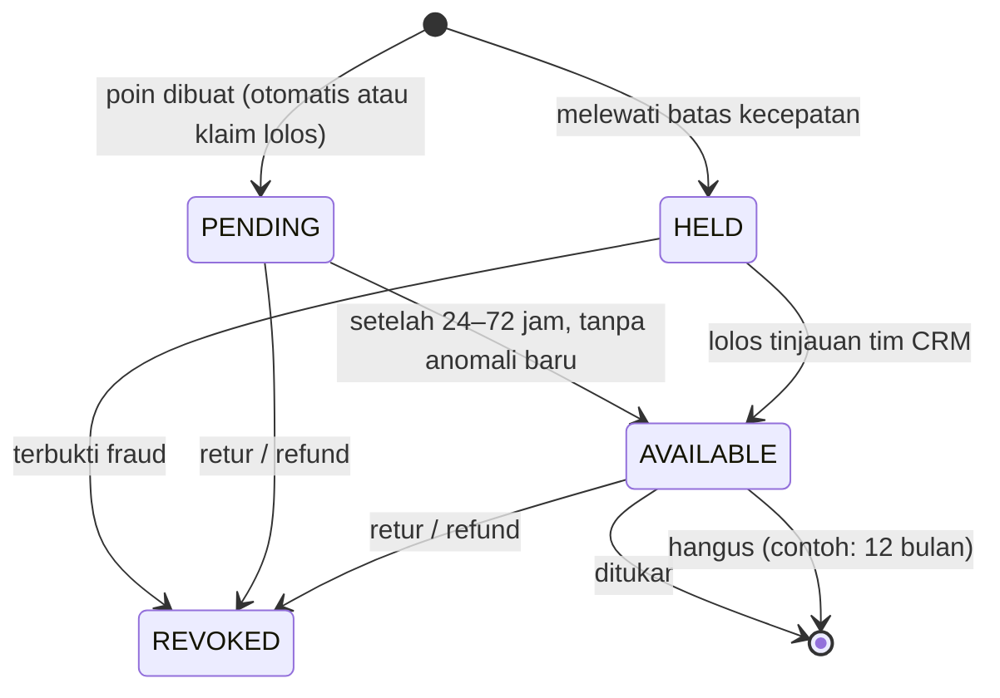

# Product Defense — mGanik Consumer Goods

> Dokumen ini adalah **Analisis Solusi Kasus Operasional** (deliverable 3): penjelasan terstruktur untuk 4 kasus di bagian "Tantangan Produk & Operational Edge Cases" pada assignment, disertai batasan sistem (*trade-offs*) dan metrik bisnisnya.
> Detail teknis ada di `ARCHITECTURE.md`. Rujukan `§x` mengarah ke dokumen itu; rujukan ke dokumen ini ditulis "bagian x".
> Angka yang ditandai *contoh* adalah titik awal untuk didiskusikan, bukan data. Semuanya disetel ulang dari data nyata setelah berjalan.

---

## Daftar Isi

1. [Ringkasan](#1-ringkasan)
2. [Asumsi](#2-asumsi)
3. [Prinsip Produk](#3-prinsip-produk)
4. [Kasus 1 — Distribusi & Logistik (Kebocoran Wilayah & Gray-Market Diversion)](#4-kasus-1--distribusi--logistik-kebocoran-wilayah--gray-market-diversion)
5. [Kasus 2 — CRM & Loyalty (Poin Reward Konsumen & Anti-Fraud Scan)](#5-kasus-2--crm--loyalty-poin-reward-konsumen--anti-fraud-scan)
6. [Kasus 3 — Marketing (Tracking Leads-to-Purchase: Iklan Instagram ke Penjualan Indomaret)](#6-kasus-3--marketing-tracking-leads-to-purchase-iklan-instagram-ke-penjualan-indomaret)
7. [Kasus 4 — POS OwnStore (Resiliensi Offline-First & Split-Brain Stok)](#7-kasus-4--pos-ownstore-resiliensi-offline-first--split-brain-stok)
8. [Siapa Menindaklanjuti Anomali](#8-siapa-menindaklanjuti-anomali)
9. [Urutan Rollout](#9-urutan-rollout)
10. [Apa yang Dibangun vs Didesain](#10-apa-yang-dibangun-vs-didesain)

---

## 1. Ringkasan

| Kasus | Inti solusi | Metrik utama (Rupiah) |
|---|---|---|
| **1. Distribusi & Logistik** (Kebocoran Wilayah & Gray-Market Diversion) | Setiap pallet, karton, dan satuan punya QR unik dan diikat ke distributor saat dikirim. Data logistik dan scan konsumen menunjuk pallet yang bocor. Test-buy hanya mengonfirmasi. | Nilai subsidi yang bocor per bulan |
| **2. CRM & Loyalty** (Poin Reward Konsumen & Anti-Fraud Scan) | **Verifikasi** keaslian dipisah dari **poin**. Kanal sendiri: poin masuk otomatis ke pembeli. Kanal mitra: poin hanya dengan kode lapis dalam atau struk. Scan QR luar tidak pernah membuat poin. | Nilai poin yang diberikan ke klaim fraud |
| **3. Marketing** (Tracking Leads-to-Purchase: Iklan Instagram ke Penjualan Indomaret) | Solusi data hibrida: *dynamic claim voucher* / *geofencing promo*, insentif scan kemasan pasca-beli kasir, dan korelasi telemetri kenaikan distribusi per rayon yang diuji dengan eksperimen **geo-holdout**. Klaim kausalitas hanya dari eksperimen. | iROAS (margin inkremental ÷ biaya kampanye) |
| **4. POS OwnStore** (Resiliensi Offline-First & Split-Brain Stok) | Kasir tetap jalan offline. Penjualan fisik **selalu diterima**. Order online yang kalah dialihkan otomatis atau dikompensasi dengan SLA jelas. | Biaya kompensasi + penjualan online yang hilang karena buffer |

Satu benang merah: **scan konsumen adalah aset data utama**. Scan yang sama dipakai untuk anti-counterfeit (Pilar A), deteksi gray market (Kasus 1), dan sinyal per wilayah untuk atribusi (Kasus 3). Karena itu insentif agar konsumen mau scan adalah investasi bersama beberapa kasus. Baseline semua metrik diukur di fase 1 rollout (bagian 9), lalu target ditetapkan dari baseline itu.

---

## 2. Asumsi

| # | Asumsi | Jika salah |
|---|---|---|
| A1 | Setiap unit diberi stiker hologram ber-QR **di lini produksi**, dan karton serta pallet diberi QR saat dikemas. Hubungan **Pallet → Karton → Satuan** direkam oleh stasiun scan di ujung lini. | Agregasi (Kasus 1) tidak bisa dibuktikan. Perlu scan agregasi manual di gudang sebelum kirim. |
| A2 | Gudang memindai QR pallet atau karton saat mengirim ke distributor, dan setiap pengiriman punya nomor surat jalan (DO) | `partner_id` tidak terikat, jadi kebocoran tidak bisa diatribusikan ke distributor |
| A3 | Konsumen bisa memindai QR dengan kamera HP dan membuka halaman web, tanpa aplikasi | Coverage scan turun. Semua kasus yang bergantung pada scan melemah. |
| A4 | **Scan coverage rendah**: hanya sebagian kecil unit terjual yang pernah dipindai konsumen. Angka pastinya diukur di fase 1. | Jika coverage tinggi, ambang deteksi bisa diperketat |
| A5 | Kita punya data pengiriman ke **DC Indomaret** per **rayon** (di dokumen ini: area layanan satu DC), tetapi **tidak** punya data sell-out per toko Indomaret | Jika laporan sell-out supplier dari Indomaret bisa dibeli, Kasus 3 jauh lebih mudah |
| A6 | Satu toko OwnStore bisa punya beberapa perangkat POS, dan internet toko bisa putus berjam-jam | — |
| A7 | Order online D2C bisa dipenuhi dari stok OwnStore (kirim dari toko atau ambil di toko) | Jika tidak, Kasus 4 tidak terjadi, karena stok toko dan stok online tidak pernah bersinggungan |
| A8 | Harga subsidi distributor daerah berbeda nyata dengan harga kota besar, dan itu motif utama kebocoran | Jika motifnya lain (misalnya stok menumpuk), solusinya lebih ke perencanaan alokasi daripada penegakan |

---

## 3. Prinsip Produk

1. **Jangan menghukum perilaku baik konsumen.** Mengecek keaslian di rak sebelum membeli adalah perilaku yang kita inginkan. Scan QR luar tidak pernah mengubah status unit, tidak mencatat penjualan, dan tidak memicu peringatan hanya karena satu orang lain sudah memindai (§10.4).
2. **Fakta fisik menang atas janji digital.** Barang yang sudah dibawa pulang pembeli tidak bisa ditarik. Janji online yang menyesuaikan.
3. **Bukti bertingkat sebelum tindakan komersial.** Satu scan aneh bukan alasan menindak distributor. Tindakan butuh bukti yang bisa ditunjukkan di meja negosiasi.
4. **Klaim kausalitas hanya dari eksperimen.** Korelasi dipakai untuk memantau, bukan untuk menyimpulkan bahwa iklan berhasil.
5. **Data pribadi seminimal mungkin (UU PDP, UU 27/2022).**

| Data | Tujuan | Aturan |
|---|---|---|
| Lokasi scan | Deteksi kloning dan gray market | Minta izin dengan alasan yang jelas. Setelah aturan dijalankan, simpan level kabupaten/kota saja, bukan lat/lng mentah. |
| ID device anonim | Membedakan scan dari orang yang berbeda | Tidak dihubungkan ke identitas tanpa login |
| Foto struk, nomor HP, akun member | Klaim poin dan atribusi kampanye | Persetujuan eksplisit per tujuan; ada masa simpan; bisa dihapus atas permintaan |

---

## 4. Kasus 1 — Distribusi & Logistik (Kebocoran Wilayah & Gray-Market Diversion)

### 4.1 Masalah

Distributor daerah mendapat alokasi stok harga subsidi khusus, lalu menjualnya kembali ke marketplace kota besar dengan harga banting. Akibatnya:
- harga pasar rusak, dan reseller resmi di kota besar kalah bersaing,
- subsidi daerah tidak sampai ke konsumen daerah,
- tanpa bukti, perusahaan hanya bisa menegur berdasarkan dugaan.

### 4.2 Membuktikan titik kebocoran distributor secara presisi tanpa inspeksi fisik manual

**Langkah 1 — Ikat unit ke distributor saat barang keluar gudang.**
Gudang memindai QR pallet (atau karton) saat mengirim. Karena serialisasi agregasi **Pallet → Karton → Satuan** sudah direkam di lini produksi (§8.2–8.3), satu scan itu mengikat **semua unit di dalamnya** ke distributor tujuan (`serial.partner_id`) dan ke nomor surat jalan. Petugas gudang tidak memindai unit satu per satu.

**Langkah 2 — Gabungkan dua sumber data.**

| Sumber | Sinyal | Apa yang ditunjukkan |
|---|---|---|
| **Data logistik** (pengiriman ke distributor) | Volume order distributor naik, tetapi scan konsumen di wilayahnya **tidak** ikut naik | Barang dikirim ke wilayah itu, tetapi tidak dikonsumsi di sana |
| Data logistik | Jeda pendek antara tanggal kirim pallet dan scan pertama di wilayah lain | Barang langsung dialihkan, bukan sisa stok lama |
| **Scan konsumen** | Unit milik alokasi distributor dipindai di luar wilayahnya (`OUT_OF_REGION`, §10.3) | Lokasi tujuan kebocoran |
| Scan konsumen + agregasi | Banyak unit dari **pallet yang sama** muncul di luar wilayah | Pallet dan tanggal kirim yang bocor |

**Langkah 3 — Tingkat bukti** (§8.4):

| Tingkat | Kondisi | Tindakan | Pemilik |
|---|---|---|---|
| Sinyal | 1 unit di luar wilayah, atau anomali volume order vs scan | Dicatat saja | Sistem |
| Indikasi | ≥ 3 unit **dan** ≥ 30% dari unit pallet itu yang pernah dipindai, berada di luar wilayah (*contoh*) | Peringatan ke tim sales area | Sales area / trade marketing |
| Bukti | Indikasi + test-buy dari seller marketplace yang dicurigai menghasilkan unit dari pallet yang sama | Dasar penegakan kontrak (bagian 4.3) | Head of sales + legal |

Ambangnya **relatif**, karena scan coverage rendah (A4). Ambang absolut seperti "≥ 30 unit" mungkin tidak pernah tercapai.

**Kenapa ini tetap "tanpa inspeksi fisik":** sistem sudah menunjuk rantai lengkapnya sebelum ada orang yang turun ke lapangan, yaitu satuan → karton → pallet → surat jalan → distributor → tanggal kirim. Test-buy adalah **pembelian biasa** dari marketplace, bukan inspeksi gudang distributor. Gunanya hanya untuk mengunci bukti yang sudah ditunjuk sistem.

**Contoh narasi bukti:**
> Pallet `MGPAL7Q2K9` (480 unit) dikirim ke Distributor Medan dengan surat jalan DO-1031 pada 3 Oktober. Order distributor itu bulan ini naik 40%, tetapi scan di Sumatera Utara datar. Dari 14 unit pallet itu yang pernah dipindai, 6 dipindai di Jakarta (indikasi). Test-buy dari toko marketplace "X" pada 28 Oktober menghasilkan 3 unit, ketiganya dari karton di pallet yang sama (bukti).

### 4.3 Penegakan: kontrak subsidi, bukan kontrol harga (*usulan, perlu review legal*)

Penegakan dibingkai sebagai **kepatuhan kontrak subsidi**: harga khusus diberikan dengan syarat barang dijual di wilayah distributor. Harga jual kembali **tidak** diatur. Harga di marketplace hanya dipakai sebagai sinyal untuk memilih target test-buy, bukan sebagai target yang harus dicapai. Ini menghindari kesan penetapan harga jual kembali atau pembatasan wilayah yang dilarang UU 5/1999. Kepastiannya tetap perlu dikaji tim legal.

| Pelanggaran | Tindakan |
|---|---|
| Pertama, terbukti | Teguran tertulis + bukti; distributor menjelaskan jalur keluarnya barang |
| Kedua | Selisih subsidi untuk unit yang bocor ditagih kembali (*clawback*) sesuai kontrak |
| Berulang | Evaluasi kontrak distribusi |

### 4.4 Batasan sistem (trade-offs)

| Batasan | Dampak | Mitigasi |
|---|---|---|
| Biaya serialisasi: stiker hologram per unit dan stasiun scan agregasi di lini produksi | Biaya per unit dan investasi awal naik (perlu dihitung dengan tim produksi) | Mulai dari SKU bernilai tinggi dan distributor dengan selisih harga subsidi terbesar |
| Deteksi lewat scan hanya menangkap unit yang dipindai konsumen | Kebocoran ke konsumen yang tidak pernah scan tidak terlihat | Sinyal logistik (volume order vs scan) tidak bergantung pada scan per unit; test-buy aktif |
| Lokasi browser bisa ditolak atau dipalsukan | Sebagian scan tanpa lokasi | Bukti akhir dari test-buy, bukan dari lokasi scan |
| Stiker bisa dicopot | Unit tidak bisa dilacak | Stiker yang rusak jika dilepas (*void sticker*). Produk tanpa stiker di marketplace sudah menjadi sinyal test-buy. |
| Repack oleh distributor memutus hubungan karton–pallet | Bukti tingkat pallet hilang | Unit tetap membawa `partner_id`; bukti per unit masih ada |

### 4.5 Metrik bisnis

| Metrik | Definisi |
|---|---|
| **Subsidi bocor (Rp/bulan)** | Unit terbukti bocor × selisih harga subsidi |
| Leakage rate per distributor | Unit alokasi yang dipindai di luar wilayah ÷ unit alokasi yang dipindai |
| Time-to-detect | Hari dari pengiriman pallet sampai indikasi pertama |
| Scan coverage | Unit yang pernah dipindai ÷ unit terjual (syarat agar metrik lain bermakna) |

---

## 5. Kasus 2 — CRM & Loyalty (Poin Reward Konsumen & Anti-Fraud Scan)

### 5.1 Masalah

Konsumen mendapat poin loyalti saat memindai QR kemasan untuk ditukarkan reward. Oknum kasir atau perantara memindai QR di rak **sebelum** barang terjual, lalu mengambil poinnya. Pembeli asli kehilangan poin, dan perusahaan membayar poin untuk penjualan yang tidak diwakili pelanggan nyata.

### 5.2 Akar masalah

Sistem lama menyamakan **"memindai QR"** dengan **"memiliki barang"**. QR luar bisa dipindai siapa saja yang bisa melihat kemasan. Jadi QR luar tidak boleh menjadi syarat poin.

### 5.3 Validasi kepemilikan asli: poin ditentukan oleh **kanal penjualan**, bukan oleh scan

| Kanal | Cara poin dibuat | Kenapa aman |
|---|---|---|
| **OwnStore (POS)** | **Otomatis** saat transaksi. Member menunjukkan QR dari aplikasinya sendiri atau memasukkan OTP. | Kasir tidak mengetik ID member, jadi tidak bisa mengalihkan poin pembeli anonim ke akunnya sendiri |
| **D2C** | **Otomatis** ke akun pemesan, saat order **diterima** pembeli | Packer dan kurir tidak pernah memegang hak poin |
| **Mitra (Indomaret, dll.)** | Member mengklaim dengan **kode lapis dalam** (di balik segel, hanya terlihat setelah dibuka) atau **foto struk** | Kasir tidak bisa melihat kode dalam tanpa merusak segel. Kemasan rusak di rak langsung ketahuan. |

**Scan QR luar tidak pernah membuat poin.** Konsumen tetap bebas memindai untuk mengecek keaslian (prinsip 1).

**Pencegahan multi-claim:**

| Celah | Pencegahan |
|---|---|
| Satu serial diklaim berkali-kali | `UNIQUE (serial_id)` di tabel poin, dijaga database (§21) |
| Satu struk dipakai untuk banyak klaim | Kunci struk = toko + nomor struk + waktu. Jumlah serial yang diklaim dengan struk yang sama ≤ jumlah unit di struk. |
| Banyak akun dari satu perangkat | Klaim dari satu perangkat untuk banyak akun ditandai untuk ditinjau |
| Klaim borongan | Batas kecepatan per member dan per titik lokasi (*contoh*: > 10 klaim/jam → `HELD`); batas poin per member per hari |

### 5.4 Siklus aktivasi poin



- **Pending 24–72 jam** (*contoh*) memberi waktu untuk menemukan anomali sebelum poin bisa ditukar.
- **Retur atau refund** mencabut poin dari unit itu. Jika poin sudah ditukar, saldo member dikurangi.
- **Masa berlaku** membatasi kewajiban poin yang menumpuk di neraca.

### 5.5 Batasan sistem (trade-offs)

| Trade-off | Dampak | Kenapa tetap dipilih |
|---|---|---|
| Kode lapis dalam menambah biaya kemasan | Biaya produksi per unit naik (perlu dihitung dengan tim kemasan) | Hanya untuk SKU yang dijual di kanal mitra; mulai dari SKU dengan nilai poin terbesar |
| Upload struk menambah langkah | Sebagian konsumen tidak jadi klaim | Klaim yang hilang adalah klaim berisiko tinggi |
| Poin pending membuat konsumen menunggu | Pengalaman sedikit menurun | Komunikasikan dengan jelas: "Poin aktif dalam 48 jam" |
| Batas kecepatan bisa menahan pembeli grosir yang sah | False positive | `HELD` ditinjau manusia, bukan ditolak otomatis |
| Member di OwnStore harus membuka aplikasi | Antrean kasir sedikit lebih lama | Tanpa ini, kasir bisa mengalihkan poin pembeli anonim |

### 5.6 Metrik bisnis

| Metrik | Definisi |
|---|---|
| **Poin ke klaim fraud (Rp/bulan)** | Nilai poin dari klaim yang di-`REVOKED` karena fraud |
| Fraud rate | Klaim terbukti fraud ÷ total klaim |
| Claim rate kanal mitra | Unit terjual di mitra yang diklaim ÷ perkiraan unit terjual. Dijaga agar tidak anjlok karena friksi. |
| Presisi `HELD` | Klaim `HELD` yang terbukti fraud ÷ semua klaim `HELD` |
| Kewajiban poin (Rp) | Nilai poin `AVAILABLE` yang belum ditukar |

---

## 6. Kasus 3 — Marketing (Tracking Leads-to-Purchase: Iklan Instagram ke Penjualan Indomaret)

### 6.1 Masalah

Kita perlu membuktikan korelasi belanja iklan online (Instagram/TikTok Ads) terhadap lonjakan penjualan fisik (*sell-out*) di gerai Indomaret. Sistem POS Indomaret adalah *black-box* (tanpa integrasi API realtime), jadi atribusi *leads-to-purchase* tidak bisa dilihat langsung.

### 6.2 Prinsip

Tidak ada satu sinyal yang sempurna. Gunakan **beberapa sinyal**, pahami bias masing-masing, dan buat klaim kausalitas **hanya dari eksperimen**.

### 6.3 Solusi data hibrida: tiga sinyal

| Sinyal | Cara kerja | Kekuatan | Bias / kelemahan |
|---|---|---|---|
| **S1. Dynamic claim voucher / geofencing promo** | Iklan memberi **kode sekali pakai** per klik atau per member, bukan kode statis yang bisa bocor ke grup promo. Voucher hanya berlaku jika kemasan dipindai **dalam radius *contoh* 200 m dari toko Indomaret** selama periode kampanye. | Hubungan langsung iklan → pembelian → unit fisik (serial) → **toko** tempat membeli | Hanya menangkap konsumen yang aktif; ada biaya insentif |
| **S2. Insentif scan kemasan pasca-beli kasir** | Halaman scan menawarkan hadiah kecil (poin, undian). Atribusi ke kampanye lewat **login member atau nomor HP** (misalnya dari iklan click-to-WhatsApp), bukan lewat cookie, karena browser di dalam aplikasi Instagram/TikTok terpisah dari browser kamera. | Volume besar; sekaligus menaikkan scan coverage untuk Kasus 1 | Tanpa login, scan dihitung untuk metrik per wilayah tetapi tidak diatribusikan |
| **S3. Korelasi telemetri kenaikan distribusi per rayon** (diuji dengan geo-holdout) | Iklan ditargetkan ke sebagian **rayon** (*treatment*). Rayon lain yang mirip mendapat iklan lebih sedikit atau tidak sama sekali (*control*). Bandingkan perubahan scan per rayon dan pengiriman ke DC Indomaret. | **Satu-satunya yang menunjukkan kausalitas** | Butuh area kontrol; ada jeda karena siklus re-order |

### 6.4 Desain eksperimen geo-holdout (S3)

1. **Satuan wilayah = rayon.** Di dokumen ini, satu rayon = area layanan satu DC Indomaret, karena supplier mengirim ke DC dan distribusi ke toko diatur internal oleh Indomaret (A5).
2. **Pasangkan beberapa rayon** yang mirip: penjualan historis, jumlah toko, dan demografi. Cek bahwa tren keduanya sejajar sebelum kampanye (*pre-trend check*).
3. Dalam setiap pasangan, acak satu menjadi *treatment* dan satu menjadi *control*. Jika tim marketing menolak rayon tanpa iklan sama sekali, *control* cukup mendapat **anggaran lebih kecil**.
4. Periode: 4 minggu sebelum kampanye (*baseline*), lalu 4 minggu kampanye (*contoh*).
5. Ukur dengan *difference-in-differences*:

```
lift = (treatment_sesudah − treatment_sebelum) − (control_sesudah − control_sebelum)
```

   | Ukuran | Peran |
   |---|---|
   | Scan konsumen per 1.000 unit yang dikirim ke rayon itu | **Utama**, muncul lebih cepat |
   | Pengiriman ke DC Indomaret di rayon itu | Konfirmasi, muncul belakangan karena siklus re-order |

6. Kalibrasi rasio scan terhadap penjualan dari OwnStore, karena di sana penjualan nyata diketahui. Rasio ini dipakai untuk memperkirakan sell-out Indomaret dari jumlah scan.

### 6.5 Dukungan sistem

- `scan_event` sudah mencatat serial, lokasi, dan waktu (§10). Untuk S1 dan S2 cukup ditambah kode kampanye (tidak dibangun di prototype).
- Serial yang dipindai bisa ditelusuri ke distributor dan wilayah pengirimannya (§8.4), jadi scan bisa dikelompokkan per rayon untuk S3.

### 6.6 Batasan sistem (trade-offs)

| Batasan | Dampak | Sikap |
|---|---|---|
| Korelasi ≠ kausalitas | Lonjakan bisa karena musim, promo Indomaret sendiri, atau stok kosong sebelumnya | Hanya S3 yang dipakai untuk menyimpulkan efek iklan |
| Rayon kontrol mendapat iklan lebih sedikit | Ada penjualan yang hilang selama eksperimen | Eksperimen singkat dan terbatas; nilai keputusannya lebih besar dari biayanya |
| Konsumen yang ikut S1/S2 tidak mewakili semua konsumen | Angka absolut bias ke atas | S1/S2 dipakai untuk membandingkan kampanye, bukan untuk menghitung total penjualan |
| Geofence bergantung pada izin lokasi | Sebagian konsumen tidak bisa memakai voucher | Kode tetap bisa dipakai dengan foto struk sebagai alternatif bukti lokasi |

### 6.7 Metrik bisnis

| Metrik | Definisi |
|---|---|
| **iROAS** | Margin dari unit inkremental ÷ biaya kampanye |
| Incremental lift per rayon | Hasil *difference-in-differences* di bagian 6.4 |
| Biaya per unit inkremental | Biaya kampanye ÷ unit inkremental |
| Redemption rate S1 | Voucher yang dipakai ÷ kode yang dibagikan, per kampanye |

---

## 7. Kasus 4 — POS OwnStore (Resiliensi Offline-First & Split-Brain Stok)

### 7.1 Masalah

Gerai fisik resmi sedang padam internet (*offline*) dan menjual unit terakhir di rak. Pada detik yang sama, order online masuk untuk unit itu, karena server mengira stok masih ada. Saat toko online lagi, ada dua pelanggan untuk satu barang.

### 7.2 Strategi POS offline-first dan sinkronisasi rekonsiliasi

**Lapis 1 — Pencegahan** (§12.3, §13.6)

| Mekanisme | Cara kerja |
|---|---|
| Heartbeat **per perangkat** POS | Setiap perangkat mengirim sinyal hidup setiap menit. Jika **satu saja** perangkat aktif tidak mengirim sinyal lebih dari 5 menit, stok toko itu **tidak dijual online**. |
| Buffer online | Unit terakhir (*contoh*: 1) di setiap toko tidak ditawarkan online. Unit itu disisakan untuk pembeli walk-in. |
| Stok toko hanya untuk **D2C** | Order marketplace tidak diambil dari stok toko. Pembatalan dari sisi seller di marketplace menurunkan skor toko dan bisa kena penalti, jadi order marketplace tidak boleh menjadi korban konflik. |

Lapisan ini membuat konflik **jarang**, tetapi tidak nol. Konflik masih bisa terjadi pada jeda sebelum 5 menit.

**Lapis 2 — Kasir tidak pernah berhenti** (§13.1–13.4)

| Hal | Saat offline |
|---|---|
| Transaksi | Disimpan di **outbox lokal**, masing-masing dengan ID unik yang dibuat di perangkat. Saat online, outbox dikirim. Pengiriman ulang tidak pernah memotong stok dua kali. |
| Pembayaran | Tunai, atau EDC dengan koneksi SIM sendiri. QRIS dinonaktifkan saat offline. Data pembayaran ikut di payload transaksi yang idempoten, jadi tidak ada double-charge. |

**Lapis 3 — Penyelesaian konflik yang adil** (§13.5)
1. Penjualan kasir **diterima**, karena barang sudah dibawa pulang dan uang sudah diterima.
2. Sistem menghitung kekurangan stok, lalu melepas reservasi **order online D2C terbaru** untuk SKU itu.
3. Order itu ditandai `NEEDS_REALLOCATION` dan langsung masuk alur pemulihan di bawah.

### 7.3 Konflik alokasi yang adil bagi pelanggan toko dan online

| | Pelanggan toko | Pelanggan online |
|---|---|---|
| Status barang | Sudah di tangan | Belum dikirim |
| Bisa dibatalkan? | Tidak, tanpa mengambil kembali barang dari orang yang sudah pergi | Ya, dan bisa dialihkan ke gudang lain |
| Kerugian jika kalah | Tidak bisa dipulihkan | Bisa dikompensasi |

Jam perangkat tidak dipakai untuk menentukan siapa yang lebih dulu, karena jam perangkat offline tidak bisa dipercaya. Hasilnya juga tetap sama: barangnya sudah keluar.

### 7.4 Alur pemulihan untuk pelanggan online (*usulan*)

| Langkah | Target |
|---|---|
| Coba alihkan ke gudang/hub lain dengan estimasi kirim yang sama | Otomatis, segera setelah sync |
| Jika berhasil | Pelanggan diberi tahu sumber pengiriman berubah; tidak ada kompensasi |
| Jika gagal | Notifikasi ke pelanggan **< 15 menit** setelah toko sync |
| Pilihan untuk pelanggan | (a) Tunggu restock dengan estimasi tanggal, atau (b) batal + refund otomatis + voucher (*contoh*: 10% nilai order) |

**Kenapa order terbaru yang dilepas:** order lama sudah lebih lama menunggu, lebih mungkin sudah dibayar, dan mungkin sedang di-picking. Ini kebijakan bisnis yang bisa diganti, misalnya "lepas yang belum dibayar dulu".

### 7.5 Batasan sistem (trade-offs)

| Trade-off | Dampak | Cara menyetel |
|---|---|---|
| Buffer online | Sebagian unit tidak dijual online | Setel per toko dari data konflik (lihat metrik) |
| Satu perangkat bermasalah menahan stok toko dari online | Penjualan online toko itu berhenti sampai ops menonaktifkan perangkatnya | Lebih baik daripada konflik yang tidak terlihat |
| Jendela 5 menit | Konflik masih mungkin dalam 5 menit pertama offline | Lebih pendek = lebih sedikit konflik, tetapi toko lebih sering hilang dari online karena gangguan singkat |
| Satu order dilepas utuh (semua item) | Pelanggan kehilangan item lain di order yang sama | Sederhana dan jelas untuk pembeli; split order di luar scope |
| Data lokal POS hilang sebelum sync (perangkat rusak) | Transaksi hilang; idempotensi tidak bisa menolong | Celah terlihat dari lompatan nomor urut perangkat; dicocokkan dengan kas toko |

### 7.6 Metrik bisnis

| Metrik | Definisi |
|---|---|
| **Biaya konflik (Rp/bulan)** | Voucher + refund akibat konflik |
| Conflict rate | Order `NEEDS_REALLOCATION` per 1.000 order D2C dari toko |
| Auto-reallocation rate | Konflik yang selesai dengan pengalihan otomatis ÷ total konflik |
| Penjualan online yang hilang karena buffer | Permintaan D2C yang ditolak karena buffer |

**Aturan penyetelan buffer per toko:** naikkan buffer jika biaya konflik lebih besar dari penjualan online yang hilang karena buffer, dan turunkan jika sebaliknya.

---

## 8. Siapa Menindaklanjuti Anomali

Deteksi tanpa pemilik tidak menghasilkan apa-apa.

| Anomali | Pemilik | Target waktu (*contoh*) | Tindakan |
|---|---|---|---|
| `OUT_OF_REGION` tingkat indikasi (Kasus 1) | Sales area / trade marketing | 5 hari kerja | Test-buy di marketplace kota tersebut; jika terbukti, eskalasi ke bagian 4.3 |
| `IMPOSSIBLE_TRAVEL` (QR dikloning) | Brand protection | 3 hari kerja | Telusuri lokasi scan; jika berulang dari satu area, test-buy di area itu |
| Klaim `HELD` (Kasus 2) | Tim CRM | 2 hari kerja | Tinjau; `AVAILABLE` atau `REVOKED` |
| `OVERSOLD` (Kasus 4) | Customer service + operasional toko | < 15 menit (otomatis) | Pastikan pelanggan online menerima notifikasi dan pilihan (bagian 7.4) |

Anomali operasional lain (`SCAN_BEFORE_RELEASE`, `POS_SERIAL_MISMATCH`, lonjakan kode tidak dikenal) masuk antrean operasional gudang, toko, dan brand protection dengan target 1 hari kerja. Dashboard antrean anomali tidak dibangun di prototype; datanya sudah ada di tabel `anomaly` dan `scan_event`.

---

## 9. Urutan Rollout

Urutannya mengikuti **ketergantungan data**: setiap fase menyiapkan data untuk fase berikutnya.

| Fase | Isi | Kenapa urutan ini |
|---|---|---|
| **1** | Serialisasi di pabrik + halaman verifikasi + POS OwnStore offline-first. **Ukur baseline** semua metrik, termasuk scan coverage. | Fondasi. Tanpa serial dan scan, kasus lain tidak punya data. POS memberi data penjualan nyata untuk kalibrasi. |
| **2** | Scan pallet saat kirim ke distributor + deteksi gray market + test-buy | Butuh serial dari fase 1. Dampak finansialnya langsung (subsidi yang bocor). |
| **3** | Poin otomatis kanal sendiri + klaim kode dalam untuk SKU kanal mitra | Butuh data penjualan dari fase 1. Kode dalam butuh waktu perubahan kemasan. |
| **4** | Kampanye dengan voucher dinamis + eksperimen geo-holdout | Butuh scan coverage yang cukup dari fase 1–3 dan data per wilayah dari fase 2 |

---

## 10. Apa yang Dibangun vs Didesain

| Bagian | Dibangun di prototype | Hanya didesain |
|---|---|---|
| Kasus 1 | Agregasi serial, aturan `OUT_OF_REGION`, query cluster per pallet (dites). `partner_id` diisi lewat seed. | Endpoint ship/receive, sinyal volume order vs scan, test-buy, penegakan kontrak |
| Kasus 2 | Verifikasi keaslian; scan QR luar tidak mengubah status di rak | Seluruh poin: pembuatan otomatis, klaim kode dalam/struk, siklus status, batas kecepatan |
| Kasus 3 | `scan_event` dengan lokasi; penelusuran serial ke distributor | Voucher dinamis, geofence, eksperimen geo-holdout |
| Kasus 4 | POS sync idempoten, heartbeat per perangkat, buffer, stok toko hanya D2C, penyelesaian `OVERSOLD` | Aplikasi POS, realokasi otomatis, notifikasi dan kompensasi |

Pembagian ini disengaja. Bagian yang dibangun adalah bagian yang **bisa salah secara data**: konkurensi, idempotensi, dan aturan status. Bagian yang hanya didesain adalah kebijakan dan proses yang perlu keputusan bisnis.
